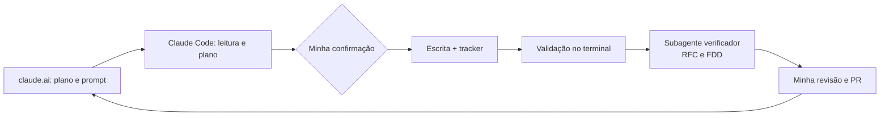

# Da Reunião ao Documento: Design Docs Gerados por IA

O enunciado original do desafio está no repositório base: [devfullcycle/mba-ia-desafio-design-docs-com-ia](https://github.com/devfullcycle/mba-ia-desafio-design-docs-com-ia).

## Sobre o desafio

O ponto de partida era a transcrição (`TRANSCRICAO.md`) de uma reunião de cerca de 55 minutos entre cinco pessoas sobre um Sistema de Webhooks de Notificação de Pedidos para um Order Management System em produção. Ela era a única fonte de decisões. O código da aplicação servia de contexto, com os nomes reais de arquivos, classes e padrões que os documentos precisavam citar.

A tarefa foi transformar isso num pacote de design docs (PRD, ADRs, RFC, FDD e um tracker de rastreabilidade) usando IA como ferramenta principal, sem inventar nada. Todo requisito, decisão ou restrição precisava apontar para uma fala `[hh:mm] Nome` ou para um arquivo do código. Quando a reunião não definia algo, o documento dizia "Não definido na reunião" em vez de preencher com um valor plausível. A entrega é puramente documental: `src/`, `prisma/`, `tests/` e as configurações não foram alterados.

## Ferramentas de IA utilizadas

- **Claude no claude.ai** (Projeto "MBA"): planejamento. Lia o repositório, a transcrição e o código, apontava armadilhas e escrevia comigo os prompts de cada etapa.
- **Claude Code no VS Code**, com o modelo Claude Opus 5.5 (o dos trailers `Co-Authored-By` dos commits): execução dos prompts, escrita dos documentos, validações no terminal e commits.
- **Subagentes do Claude Code**: verificadores independentes na RFC e no FDD, que recebiam só os caminhos dos arquivos e um prompt adversarial, para não herdar os vieses de quem escreveu.

## Workflow adotado

No claude.ai eu planejava a etapa e montava o prompt. No Claude Code eu o executava e respondia às paradas. Depois revisava a entrega e levava o resultado de volta para planejar a etapa seguinte. Cada documento foi para a `main` por um pull request próprio (#1 a #4).

A ordem real foi **PRD, ADRs, RFC, FDD e README**. Depois do PRD cheguei a montar o prompt da RFC, mas na revisão percebi que a RFC precisa linkar pelo menos 2 ADRs, que ainda não existiam. Voltei atrás, fiz os ADRs antes, como o enunciado sugere, e refiz o prompt da RFC com eles prontos.

O mesmo padrão se repetiu em todas as etapas:

1. **Planejamento com parada:** leitura das fontes e um plano (alternativas, lacunas, esqueleto), e só depois da minha confirmação a escrita.
2. **IDs visíveis:** cada item tem um ID no texto (`PRD-FR-08`, `RFC-QA-01`, `FDD-HIP-01`), que vira uma linha do tracker com a fonte.
3. **Validação no terminal**, sem scripts no repositório: citações, caminhos, IDs, links e ausência de travessão longo.
4. **Verificação independente** na RFC e no FDD, com até três rodadas de subagente. Cada apontamento era aplicado ou recusado com motivo.



## Prompts customizados

Os prompts completos têm de 180 a 257 linhas. Abaixo estão trechos copiados sem alteração, com cortes marcados por `[...]`.

**Entrevista simulada do PRD.** Usei o roteiro de PRD do curso, mas o Claude Code fazia o entrevistador e os cinco participantes, e eu confirmava cada etapa. Estas regras impediram os "participantes" de inventar respostas. O último item desliga os defaults do roteiro, que contradiziam a rastreabilidade.

```markdown
## 2. Regras para as respostas dos participantes

Estas são as regras mais importantes deste prompt. Elas existem porque toda informação do PRD precisa ser rastreável à transcrição ou ao código, e o desafio proíbe inventar requisitos, decisões ou restrições.

1. **Fonte única.** Um participante só pode afirmar algo que ele mesmo disse, ou que ouviu outra pessoa dizer, na reunião. Fatos sobre o sistema existente podem vir do código. O tom e o jeito de falar podem ser inferidos das falas; fatos, números, nomes, prazos e decisões não podem.
2. **Toda resposta com conteúdo termina com fontes** no formato `[hh:mm] Nome`, com horário e nome exatamente como aparecem na transcrição. O participante pode se apoiar em fala de outra pessoa ("como a Sofia disse às 09:21").
3. **Janela de presença.** Diego entrou às 09:05 e não ouviu nada do que foi dito antes. Marcos e Sofia saíram às 09:50 e não sabem de nada combinado depois disso. Respeite essas janelas nas respostas.
4. **Lacuna não se preenche.** Quem não tratou do assunto responde em uma linha: "Não tratei disso na reunião." Não complete com uma opinião que pareça plausível.
5. **Correções valem.** Se algo foi dito e depois corrigido por outra pessoa, a resposta usa a versão final e cita o horário da correção. Quem perdeu uma discussão reconhece a decisão final.
6. **Descartado e adiado não viram requisito.** Se a pergunta tocar em algo que a reunião descartou ou adiou, a resposta diz isso de forma explícita e cita onde aconteceu.

[...]

## 3. Adaptações do entrevista.txt para este contexto

- **Defaults inteligentes e hipóteses estão desligados.** Não use p95 de 150 ms, 99,9 por cento de disponibilidade nem qualquer outro default do roteiro. Se nenhum participante tiver a resposta, o entrevistador registra "Não definido na reunião" e segue. Esse item não ganha linha no tracker e entra na lista de lacunas do relatório final (seção 8).
```

**As três categorias de informação do FDD.** O FDD precisa de detalhes que a reunião não discutiu. Esta regra concilia o roteiro do curso, que aceita hipóteses, com o desafio, que proíbe inventar.

```markdown
## 2. Regra das hipóteses

O FDD precisa descer a um nível de detalhe que a reunião não cobriu (nomes de colunas, rotas exatas, status codes, formato de campos). Por isso, cada informação do FDD cai em uma de três categorias:

| Categoria | O que é | Como aparece no FDD | No tracker |
| --- | --- | --- | --- |
| **Decidido** | dito ou decidido na reunião | texto normal | Fonte `TRANSCRICAO`, `[hh:mm] Nome` |
| **Padrão do código** | segue uma convenção que já existe no código (prefixo `/api/v1`, formato do corpo de erro, `@default(uuid())`, status 201 na criação, 204 na remoção) | texto normal, citando o arquivo | Fonte `CODIGO`, caminho do arquivo |
| **Hipótese de implementação** | detalhe que a reunião não decidiu e o código não determina | marcado com **(hipótese)** e com o ID `FDD-HIP-NN` | Tipo "Hipótese de implementação", Localização na fala ou no arquivo que motivou a hipótese |

Regras:

- Hipótese só pode **detalhar** uma decisão existente ou preencher uma lacuna de implementação. Nunca pode criar requisito de produto, mudar um número decidido ou trazer de volta algo descartado ou adiado.
- Toda hipótese adotada precisa da minha escolha durante a entrevista (ou da opção recomendada, se eu disser "segue direto").
- No FDD, as hipóteses também ficam reunidas na subseção "Suposições e restrições" da seção 1, como o roteiro do curso pede.
```

**Verificador adversarial da RFC.** O prompt inteiro que o subagente recebia. O do FDD tem a mesma estrutura, com critérios próprios.

```text
Você é um revisor adversarial. Seu trabalho é tentar reprovar o documento docs/RFC.md.
Seja cético: na dúvida, aponte o problema. Não confie na memória, leia os arquivos.

Arquivos de referência: README.md (enunciado do desafio), TRANSCRICAO.md, docs/PRD.md,
docs/adrs/*.md e o código em src/ e prisma/.

Verifique, citando o número da linha da RFC em cada apontamento:
1. Cada citação [hh:mm] Nome existe na transcrição e a fala sustenta o que a RFC afirma.
2. Nenhuma afirmação, mitigação, alternativa ou questão em aberto está sem origem na
   transcrição ou no código.
3. Nenhum item descartado ou adiado na reunião aparece como parte da proposta.
4. Cada caminho de arquivo citado existe.
5. Cada link para o PRD e para os ADRs aponta para um título ou arquivo que existe.
6. A RFC não contradiz o PRD nem os ADRs.
7. Problemas de altura: detalhe de implementação que pertence ao FDD, ou trecho que só
   repete o PRD ou os ADRs.
8. As seções obrigatórias do requisito 2 do README estão presentes, com pelo menos
   2 alternativas descartadas (cada uma com trade-off), pelo menos 2 questões em aberto
   e links para pelo menos 2 ADRs.

```

## Iterações e ajustes

Foram **cinco iterações principais**: uma por documento (PRD, ADRs, RFC e FDD) e a harmonização final, com 6 rodadas de verificador independente (3 na RFC e 3 no FDD).

**1. A ordem entre RFC e ADRs.** O primeiro prompt da RFC foi descartado na revisão, porque a RFC dependia de ADRs que não existiam. Saíram 7 ADRs, cobrindo as 6 decisões principais e o snapshot do payload, com 12 alternativas, todas levantadas na reunião, e só 2 consequências marcadas como inferidas.

**2. A entrevista do PRD.** Foram 12 etapas, 11 requisitos funcionais e 135 linhas no tracker. Os defaults do roteiro (como p95 de 150 ms e 99,9% de disponibilidade) foram desligados, e o que a reunião não definiu virou "Não definido na reunião". As falas corrigidas na própria reunião precisaram ser tratadas como versão final:
- o Marcos propôs o `customer_id` vindo do JWT às 09:31, e a Larissa corrigiu às 09:32 (vai no body ou no path);
- o Bruno falou em "mesmo Prisma client" às 09:11 e se corrigiu às 09:30 (instância separada, porque é outro processo).

**3. A RFC.** O curso não tinha modelo de RFC, então a estrutura saiu das seções obrigatórias do enunciado: a proposta em três blocos (captura do evento, entrega ao cliente, configuração e gestão), as alternativas de arquitetura separadas das de parâmetro e uma revisão simulada pelos quatro revisores (7 comentários, 5 aplicados). O verificador independente rodou três vezes: 15 apontamentos na primeira rodada (12 aplicados), 12 na segunda (6 aplicados e 1 em parte) e 9 na terceira (4 aplicados). Os erros mais importantes que ele pegou:
- o TL;DR prometia "entrega" em menos de 10 s, quando o PRD mede a primeira tentativa;
- uma mitigação de risco não tinha origem na reunião e foi removida;
- 6 citações apontavam a pessoa ou o minuto errados;
- a seção de impacto omitia `prisma/schema.prisma` e `src/routes/index.ts`.

**4. O FDD.** Usei o prompt de FDD do curso, copiado do Notion, com a formatação do esqueleto reconstruída. Antes de rodar, o Claude no claude.ai listou 15 ambiguidades de implementação no próprio prompt, por exemplo:
- a contagem das "5 tentativas", que não fechava com as 15 horas;
- a rotação de secret, que num webhook de saída só funciona com dupla assinatura;
- o prefixo `/api/v1`, que a reunião omitia;
- o risco de a checagem dos 64KB desfazer a mudança de status.

Com mais 11 lacunas achadas na entrevista, foram 26 hipóteses `FDD-HIP`, adotadas com a opção recomendada. O verificador rodou três vezes: 21 apontamentos (18 aplicados), 27 (22 aplicados) e 15 (14 aplicados), com falhas de desenho reais:
- a seleção do lote podia travar o worker para todos os clientes;
- o polling esperava o lote inteiro e deixava um cliente lento atrasar os outros;
- a recuperação após queda permitia mais de 6 chamadas;
- uma regra de rotação encurtava as 24 h decididas;
- havia probabilidades de risco sem origem.

**5. A harmonização final.** O `PRD-FR-08` dizia "5 tentativas no total", o que contradizia as 15 horas, e passou a dizer "5 novas tentativas depois da primeira falha". O `FDD-HIP-01` passou de "conflito a confirmar" para leitura confirmada. Marquei com "(a criar)" todo arquivo citado que a feature vai criar, como `src/worker.ts`, e retirei dos documentos as referências aos logs de trabalho.

## Como navegar a entrega

| Documento | Caminho | O que responde |
| --- | --- | --- |
| PRD | [docs/PRD.md](docs/PRD.md) | Por que e o quê: problema, público, escopo, requisitos e métricas |
| ADRs | [docs/adrs/](docs/adrs/) (índice em [docs/adrs/README.md](docs/adrs/README.md)) | Por que cada decisão foi tomada exatamente assim |
| RFC | [docs/RFC.md](docs/RFC.md) | Como pretendemos resolver e o que ficou em aberto |
| FDD | [docs/FDD.md](docs/FDD.md) | Como construir: fluxos, contratos, erros, observabilidade e integração com o código |
| Tracker | [docs/TRACKER.md](docs/TRACKER.md) | De onde veio cada item: fala da reunião ou arquivo do código |

Ordem de leitura sugerida:
1. O **PRD**: o problema e o escopo.
2. Os **ADRs**: decisões curtas, cada uma com o seu porquê.
3. A **RFC**: as decisões juntas numa proposta, com o que ficou em aberto.
4. O **FDD**: o mais longo, que depende dos anteriores.
5. O **tracker**: consultado quando surgir dúvida sobre a origem de algo.

O tracker tem 452 linhas, 381 com Fonte `TRANSCRICAO` (84,3%) e 71 com Fonte `CODIGO`. Para saber de onde veio um item, procure o ID dele no tracker. Por exemplo, `FDD-HIP-01` aparece no FDD como a hipótese da contagem de tentativas. A linha dele no tracker mostra o tipo "Hipótese de implementação" e as falas `[09:17] Diego; [09:48] Larissa`, que podem ser conferidas direto na `TRANSCRICAO.md`.
