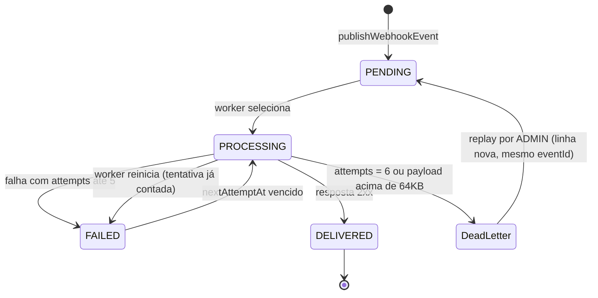

### FDD: Sistema de Webhooks de Notificação de Pedidos

Versão: 1.0
Data: 2026-11-01
Responsável: Larissa (Tech Lead)

Documentos relacionados: [PRD](./PRD.md) · [RFC](./RFC.md) · [Índice de ADRs](./adrs/README.md)

Convenção deste documento. Cada informação está em uma de três categorias:
- **Decidido na reunião:** texto normal, com citação `[hh:mm] Nome`.
- **Padrão do código:** texto normal, citando o arquivo.
- **Hipótese de implementação:** marcada com **(hipótese)** e um ID `FDD-HIP-NN`. Todas as hipóteses estão listadas em "Suposições e restrições", na seção 1. Foram adotadas na sessão de revisão registrada em `processo/entrevista-fdd.md`, com a usuária delegando as escolhas às opções recomendadas ("segue direto, decide você"). Os detalhamentos feitos durante a verificação independente estão listados no mesmo log.

---

### 1. Contexto e motivação técnica

- `FDD-CTX-01` A mudança de status do pedido roda numa transação que já atualiza o pedido, grava o histórico e mexe no estoque (`changeStatus` em `src/modules/orders/order.service.ts`). Uma chamada HTTP ao cliente dentro dela travaria a mudança de status de outros pedidos ([09:04] Bruno).
- `FDD-CTX-02` A aplicação não tem nenhum mecanismo de notificação externa: o `buildApiRouter` só monta auth, users, customers, products e orders (`src/routes/index.ts`). A feature cria um envio assíncrono, de saída, para endpoints https dos clientes ([09:03] Sofia).

**Encaixe na arquitetura**

- `FDD-CTX-03` Este FDD implementa a proposta da [RFC](./RFC.md) e os ADRs 001 a 007. O porquê de cada decisão fica neles e não é repetido aqui:
  - outbox na transação: [ADR-001](./adrs/ADR-001-outbox-no-mysql.md);
  - worker separado com polling: [ADR-002](./adrs/ADR-002-worker-separado-com-polling.md);
  - retry e DLQ: [ADR-003](./adrs/ADR-003-retry-com-backoff-e-dlq.md);
  - HMAC: [ADR-004](./adrs/ADR-004-hmac-sha256-com-secret-por-endpoint.md);
  - at-least-once: [ADR-005](./adrs/ADR-005-entrega-at-least-once-com-x-event-id.md);
  - reuso de padrões: [ADR-006](./adrs/ADR-006-reuso-dos-padroes-do-projeto.md);
  - snapshot: [ADR-007](./adrs/ADR-007-snapshot-do-payload-na-insercao.md).
- `FDD-CTX-04` Dois processos, um banco. A API (`src/server.ts`) grava o evento. O worker (`src/worker.ts`, novo) lê e envia. Os dois usam o mesmo MySQL e a mesma stack, mas não o mesmo processo ([09:11] Diego), cada um com a própria instância de `PrismaClient` ([09:30] Bruno).

**Atores**

- `FDD-CTX-05` Usuário autenticado que representa o cliente. Gerencia os webhooks com o JWT da plataforma ([09:32] Marcos). Qualquer role vale nesta fase ([09:37] Sofia).
- `FDD-CTX-06` Administrador (role `ADMIN`). É o único que reprocessa a DLQ ([09:36] Larissa).
- `FDD-CTX-07` Worker. Processo Node separado que faz polling da outbox ([09:10] Larissa).
- `FDD-CTX-08` Endpoint do cliente. URL https fora da infraestrutura da plataforma, que recebe o envio assinado ([09:19] Sofia).

**Suposições e restrições**

Restrições decididas:
- `FDD-CTX-09` Sem infraestrutura nova: outbox no MySQL existente ([09:07] Diego). Sem biblioteca nova de log ([09:29] Bruno).
- `FDD-CTX-10` O token não identifica o cliente. O `customer_id` vai no body ou no path ([09:32] Larissa). O `JwtPayload` só tem `sub`, `email` e `role` (`src/middlewares/auth.middleware.ts`).

Hipóteses de implementação (todas **(hipótese)**):

| ID | Hipótese | Âncora |
| --- | --- | --- |
| `FDD-HIP-01` | As "5 tentativas" são 5 retentativas depois da primeira falha: até 6 chamadas HTTP por evento, com espera de 1m, 5m, 30m, 2h e 12h após cada falha. São 14h36m entre a primeira falha e a última tentativa, o que fecha com as "quase 15 horas". **Conflito a confirmar:** `PRD-FR-08` e `PRD-CA-08` dizem "5 tentativas no total", e `RFC-PROP-02` e ADR-003 dizem "5 tentativas" com os mesmos 5 intervalos. Esses textos não fecham com as 15 horas. Este FDD adota a leitura de 6 chamadas, que foi a recomendada na sessão de revisão. O resumo de [09:48] Larissa ("total 5 tentativas") é lido como 5 retentativas, porque traz os mesmos 5 intervalos. A divergência de redação com os outros documentos fica registrada para correção | [09:17] Diego; [09:48] Larissa |
| `FDD-HIP-02` | `X-Signature` traz uma lista `sha256=<hex>`: a assinatura com a secret atual primeiro, seguida de uma para cada secret anterior ainda dentro das suas 24 h. O cliente aceita se qualquer uma bater | [09:21] Sofia |
| `FDD-HIP-03` | Uma linha de outbox por webhook interessado. Cada linha tem `eventId` próprio (UUID), gerado na inserção | [09:25] Diego |
| `FDD-HIP-04` | `customer_id` no path: criação e listagem em `/api/v1/customers/:customerId/webhooks`; as demais operações em `/api/v1/webhooks/:id` | [09:32] Larissa |
| `FDD-HIP-05` | A rotação de secret é `POST /api/v1/webhooks/:id/secret/rotate`, com resposta 200 e corpo `{ id, secret, previousSecretExpiresAt }`. Rotações seguidas são aceitas: cada secret substituída entra na lista `previousSecrets` com o seu próprio prazo de 24 h, e as que já venceram são removidas na rotação | [09:21] Sofia |
| `FDD-HIP-06` | Evento acima de 64KB: o worker mede o corpo antes de enviar, não envia e move o evento direto para a DLQ com motivo `WEBHOOK_PAYLOAD_TOO_LARGE`, sem retry. A mudança de status nunca é desfeita por isso | [09:24] Larissa |
| `FDD-HIP-07` | Sucesso é só resposta 2xx. Qualquer outro status, erro de rede ou timeout é falha com retry. Redirects não são seguidos | [09:42] Diego |
| `FDD-HIP-08` | O agendamento usa as colunas `attempts`, `nextAttemptAt`, `lockedAt`, `lastError` e `deliveredAt`, com índices compostos (`status`, `createdAt`) e (`status`, `nextAttemptAt`). O status `FAILED` significa "última tentativa falhou, aguardando nova tentativa"; não é a DLQ | [09:08] Diego |
| `FDD-HIP-09` | Ordem por par (webhook, pedido): o worker não envia um evento enquanto houver evento anterior não entregue do mesmo par. O bloqueio entra na consulta de seleção. Eventos bloqueados ficam fora da medida e do alerta da meta de 10 s, porque a espera é consequência aceita da ordem | [09:12] Diego |
| `FDD-HIP-10` | A tentativa é contada antes do envio, quando a linha vira `PROCESSING`. Ao iniciar, o worker devolve as linhas em `PROCESSING` para `FAILED` com retry imediato, ou as manda para a DLQ se já tiverem 6 tentativas. No `SIGINT` ou `SIGTERM`, para de buscar, espera os envios em andamento e desconecta | `src/server.ts` |
| `FDD-HIP-11` | Histórico em tabela própria, com uma linha por tentativa HTTP: `outboxId`, `eventId`, `attempt`, `startedAt` (início da chamada), `durationMs`, `statusCode`, `requestBody`, `responseBody` até 64KB (`MediumText`), o indicador `responseBodyTruncated` e `error` | [09:34] Marcos |
| `FDD-HIP-12` | `WEBHOOK_SECRET_REQUIRED` não é usado, porque a secret é gerada pela plataforma. Os schemas do POST e do PATCH usam `.strict()`, então um campo `secret` ou desconhecido é recusado com `VALIDATION_ERROR`. `events` exige pelo menos um status, e o PATCH exige pelo menos um campo | [09:31] Marcos |
| `FDD-HIP-13` | Classes de erro novas em `src/shared/errors/http-errors.ts`, no molde de `InvalidStatusTransitionError`, com os códigos `WEBHOOK_NOT_FOUND`, `WEBHOOK_INVALID_URL`, `WEBHOOK_DEAD_LETTER_NOT_FOUND` e `WEBHOOK_DEAD_LETTER_ALREADY_REPLAYED`. A exigência de https é validada por um schema Zod de URL executado no service, que lança `WebhookInvalidUrlError` | `src/shared/errors/http-errors.ts` |
| `FDD-HIP-14` | Para a revisão de segurança: a secret é gerada com `crypto.randomBytes(32)` em hex e guardada cifrada com AES-256-GCM, com a chave `WEBHOOK_SECRET_ENCRYPTION_KEY` (obrigatória, 64 caracteres hex) no `envSchema`, usada pela API e pelo worker. Os campos de secret entram no `redactPaths`. A secret só aparece nas respostas de criação e de rotação. As funções ficam em `webhook.signature.ts`. O texto cifrado é gravado como `base64(iv):base64(authTag):base64(ciphertext)`, com IV de 12 bytes. A rotação da chave de cifra não foi definida | [09:22] Diego; [09:46] Sofia |
| `FDD-HIP-15` | Métricas calculadas a partir das tabelas novas e de um log periódico `webhook_worker_stats`, com janelas de uma hora. Painel e alertas com os limiares do `FDD-OBS-12`. Tracing por correlação de `eventId`, `webhookId`, `orderId` e `requestId`. O worker loga com `logger.child({ component: 'webhook-worker' })` | [09:29] Bruno |
| `FDD-HIP-16` | O worker expõe `processBatch(now: Date)` para testes: o horário é calculado em JS e passado para as consultas, e o teste injeta o relógio. O envio HTTP é feito por uma função `send` injetável (padrão: `fetch` global), que os testes substituem por um stub. Assim o webhook é cadastrado pela API com uma URL https fictícia, e nenhum servidor TLS local é necessário. O `tests/setup.ts` apaga as tabelas novas explicitamente, antes de `customers` | `tests/setup.ts` |
| `FDD-HIP-17` | Modelo de dados: nomes de tabela e de coluna e tipos não citados na reunião. Outbox, DLQ e entregas guardam `orderId` sem FK para `orders`. O webhook tem FK com cascade para `customers`. As tabelas de eventos têm FK com cascade para `webhooks`. A remoção de webhook é definitiva (hard delete). Se o webhook for apagado durante um envio, os erros `P2003` ou `P2025` nas gravações finais são tratados como descarte | `prisma/schema.prisma` |
| `FDD-HIP-18` | A criação de pedido não gera evento. Só o `changeStatus` gera | [09:40] Bruno |
| `FDD-HIP-19` | O PATCH aceita `active`. Webhook inativo não recebe eventos novos; os já gravados seguem a entrega | [09:21] Bruno |
| `FDD-HIP-20` | `X-Timestamp` em ISO 8601 UTC, com o horário do envio, fora da assinatura. Como a assinatura é só do corpo, o header sozinho não protege contra reenvio malicioso. O `timestamp` do payload, que é assinado, e o `event_id` é que permitem ao cliente detectar replay. Ponto para a revisão da Sofia | [09:44] Diego |
| `FDD-HIP-21` | Polling em intervalo fixo de 2 s, que não espera os envios em andamento, com até 10 envios simultâneos. Os parâmetros são constantes do módulo. A lógica fica em `src/modules/webhooks/webhook.worker.ts`, com os scripts `worker` e `dev:worker` | [09:09] Diego; [09:28] Bruno |
| `FDD-HIP-22` | HTTP com o `fetch` nativo do Node 20 e `AbortSignal.timeout(10000)`. HMAC, cifra e geração de secret com o módulo `crypto` nativo. Nenhuma dependência nova | `package.json` |
| `FDD-HIP-23` | A listagem de webhooks é paginada com `paginated()`. O histórico devolve sempre as 100 entregas mais recentes, no corpo `{ data: [...] }`, sem paginação | `src/shared/http/response.ts` |
| `FDD-HIP-24` | Mover para a DLQ apaga a linha da outbox, na mesma transação que cria a linha da DLQ. O replay cria uma linha nova na outbox com o mesmo `eventId` e o mesmo payload, com `attempts = 0`, mesmo que o webhook esteja inativo, e marca a linha da DLQ com `replayedAt` e `replayedById`. Um segundo replay devolve 409. A resposta é 200, com corpo `{ deadLetterId, eventId, outboxId, status, replayedAt, replayedById }`. Sem listagem da DLQ por API, o id vem do log `webhook_dead_lettered` | [09:18] Diego |
| `FDD-HIP-25` | O payload tem só os campos citados na reunião. "Campos básicos tipo `total_cents`" vira apenas `total_cents`, e o `timestamp` é o `new Date()` do momento da publicação, dentro da transação da mudança de status | [09:43] Diego |
| `FDD-HIP-26` | `publishWebhookEvent` retorna `Promise<number>` com a quantidade de eventos gravados. É chamada depois de `orderStatusHistory.create`, e o filtro de status é feito em memória sobre os webhooks ativos do cliente. Fica em `webhook.publisher.ts` | [09:41] Bruno |

---

### 2. Objetivos técnicos

| ID | Objetivo | Medida ou invariante |
| --- | --- | --- |
| `FDD-OBJ-01` | Primeira tentativa rápida ([PRD-OBJ-01](./PRD.md#objetivos-e-métricas-de-sucesso)) | (`startedAt` da entrega com `attempt = 1`) menos (`createdAt` da linha da outbox), unidos por `outboxId`, fica abaixo de 10 s ([09:02] Marcos), com polling de 2 s ([09:10] Larissa). Exceção declarada: um evento que espera um evento anterior do mesmo par em retry (`FDD-HIP-09`) não cumpre essa meta. É uma divergência com o `PRD-CA-03`, aceita pela ordem por pedido e acompanhada à parte |
| `FDD-OBJ-02` | Nenhuma mudança de status sem evento ([09:40] Bruno) | Para todo `changeStatus` commitado com webhook ativo interessado, existe linha na outbox. Se a inserção falhar, não existe mudança de status |
| `FDD-OBJ-03` | Isolamento da mudança de status ([09:04] Bruno) | Nenhuma chamada HTTP dentro de `prisma.$transaction` do `changeStatus` |
| `FDD-OBJ-04` | Política de retry exata | Até 6 chamadas por evento, com esperas de 60 s, 300 s, 1.800 s, 7.200 s e 43.200 s **(hipótese)** `FDD-HIP-01` |
| `FDD-OBJ-05` | Timeout por chamada ([09:42] Diego) | Nenhuma chamada passa de 10.000 ms |
| `FDD-OBJ-06` | Autenticidade do envio ([09:22] Sofia) | 100% dos envios com `X-Signature` HMAC-SHA256 calculado sobre os bytes exatos do corpo |
| `FDD-OBJ-07` | Ordem por pedido com um único worker ([09:13] Larissa) | Para um mesmo par (webhook, pedido), a entrega N+1 nunca começa antes de a entrega N ser concluída ou ir para a DLQ **(hipótese)** `FDD-HIP-09` |

---

### 3. Escopo e exclusões

**Incluído**
- `FDD-ESC-01` Modelo de dados: `webhooks`, `webhook_outbox` ([09:06] Diego), `webhook_dead_letter` ([09:18] Diego) e `webhook_deliveries` **(hipótese)** `FDD-HIP-11`.
- `FDD-ESC-02` A função `publishWebhookEvent`, chamada dentro do `changeStatus` ([09:41] Bruno).
- `FDD-ESC-03` O worker `src/worker.ts`, com o script `npm run worker` ([09:11] Larissa).
- `FDD-ESC-04` O CRUD de webhooks: criar, listar, editar e remover ([09:33] Bruno).
- `FDD-ESC-05` A rotação de secret com 24 h de convivência ([09:21] Sofia).
- `FDD-ESC-06` O histórico das últimas 100 entregas ([09:34] Marcos).
- `FDD-ESC-07` O replay da DLQ por ADMIN, com log de auditoria ([09:36] Sofia).
- `FDD-ESC-08` As classes e os códigos de erro `WEBHOOK_*` ([09:29] Larissa).
- `FDD-ESC-09` Logs estruturados e métricas calculáveis sem dependência nova.

**Excluído** (justificativa no PRD)
- `FDD-FORA-01` E-mail de alerta de falha: [PRD-FORA-01](./PRD.md#escopo).
- `FDD-FORA-02` Painel visual: `PRD-FORA-02`.
- `FDD-FORA-03` Rate limiting de saída: `PRD-FORA-03`. Fica em aberto em `RFC-QA-01`.
- `FDD-FORA-04` Arquivamento da outbox: `PRD-FORA-04` e `RFC-QA-04`.
- `FDD-FORA-05` Webhooks de entrada: `PRD-FORA-05`.
- `FDD-FORA-06` Vários workers e ordem global: `PRD-FORA-06` e `RFC-QA-02`.
- `FDD-FORA-07` Exactly-once: `PRD-FORA-07`.
- `FDD-FORA-08` Truncar o payload do evento: `PRD-FORA-12`.
- `FDD-FORA-09` Restringir o CRUD por role: `PRD-FORA-13` e `RFC-QA-05`.
- `FDD-FORA-10` Listagem da DLQ por API. Não foi pedida na reunião. O administrador obtém o id da DLQ pelo log `webhook_dead_lettered` **(hipótese)** `FDD-HIP-24`.
- `FDD-FORA-11` Circuit breaker. Não foi discutido na reunião e não é proposto.

---

### 4. Fluxos detalhados e diagramas

**Modelo de dados** (`prisma/schema.prisma`). Nomes, colunas e tipos não citados na reunião são **(hipótese)** `FDD-HIP-17`. As colunas de agendamento são **(hipótese)** `FDD-HIP-08`, e as de entrega, **(hipótese)** `FDD-HIP-11`.

| Tabela | Colunas principais | Índices |
| --- | --- | --- |
| `webhooks` (nome **(hipótese)** `FDD-HIP-17`) | `id` UUID; `customerId` FK para `customers` com cascade; `url` VarChar(2048); `events` Json (lista de `OrderStatus`); `active` Boolean, default `true`; `secretCiphertext` Text; `previousSecrets` Json, default `[]`, lista de `{ ciphertext, expiresAt }` **(hipótese)** `FDD-HIP-05`; `createdAt`; `updatedAt`. Url, secret, cliente e estado ativo vêm de [09:21] Bruno | `customerId` |
| `webhook_outbox` | `id` UUID; `eventId` Char(36) único; `webhookId` FK com cascade; `orderId` Char(36) sem FK; `eventType` VarChar(64); `payload` Json; `status` enum `PENDING`, `PROCESSING`, `FAILED`, `DELIVERED` ([09:08] Diego); `attempts` Int, default 0; `nextAttemptAt` DateTime, default `now()`; `lockedAt`; `lastError` VarChar(500); `deliveredAt`; `createdAt`; `updatedAt` | índices em `status` e `createdAt` ([09:08] Diego), compostos como (`status`, `createdAt`) e (`status`, `nextAttemptAt`) **(hipótese)** `FDD-HIP-08`; (`webhookId`, `orderId`) **(hipótese)** `FDD-HIP-09` |
| `webhook_dead_letter` | `id` UUID; `eventId`; `webhookId` FK com cascade; `orderId`; `payload` Json; `reason` VarChar(64); `lastError` VarChar(500); `attempts`; `failedAt`; `replayedAt` opcional; `replayedById` Char(36) opcional. Payload, motivo e horário vêm de [09:18] Diego | `webhookId`; `eventId` |
| `webhook_deliveries` | `id` UUID; `webhookId` FK com cascade; `outboxId` Char(36); `eventId`; `attempt` Int; `startedAt` DateTime; `success` Boolean; `statusCode` Int opcional; `durationMs` Int; `requestBody` Json; `responseBody` MediumText opcional; `responseBodyTruncated` Boolean; `error` VarChar(64) opcional, só com o código (`WEBHOOK_DELIVERY_*`), enquanto o detalhe fica em `lastError` da outbox; `createdAt` | (`webhookId`, `createdAt`) |

Os ids são `@default(uuid()) @db.Char(36)`, como no resto do schema ([09:51] Larissa; `prisma/schema.prisma`).

#### `FDD-FLUXO-01` Criação do evento na outbox

1. O `PATCH /api/v1/orders/:id/status` chega ao `OrderController.changeStatus`, como hoje (`src/modules/orders/order.controller.ts`).
2. Dentro de `this.prisma.$transaction`, o `changeStatus` valida a transição (`canTransition`), ajusta o estoque, atualiza o pedido e cria o `orderStatusHistory`. Tudo isso já existe.
3. Logo depois do histórico, ele chama `publishWebhookEvent(tx, order, from, to)` ([09:41] Bruno) **(hipótese)** `FDD-HIP-26`.
4. A função busca, com o mesmo `tx`, os webhooks com `customerId = order.customerId` e `active = true` **(hipótese)** `FDD-HIP-19`, e filtra os que têm `to` na lista `events` ([09:34] Bruno).
5. Se nenhum tiver interesse, retorna 0 e nada é gravado ([09:34] Bruno).
6. Para cada webhook interessado, monta o payload (snapshot, [09:52] Larissa) com um `eventId` novo e grava uma linha `PENDING` com `nextAttemptAt = now()` **(hipótese)** `FDD-HIP-03`.
7. Se a inserção falhar, a exceção propaga, a transação faz rollback e o status não muda ([09:40] Bruno). O error middleware devolve 500 `INTERNAL_SERVER_ERROR` (`src/middlewares/error.middleware.ts`).
8. O tamanho do payload não é verificado aqui, para que a verificação nunca desfaça a mudança de status **(hipótese)** `FDD-HIP-06`.

#### `FDD-FLUXO-02` Processamento pelo worker

1. Ao iniciar, o `src/worker.ts` trata as linhas que ficaram em `PROCESSING`. A tentativa dessas linhas já foi contada antes do envio (passo 4), então elas voltam para `FAILED` com `nextAttemptAt = now`. Se já estiverem com `attempts = 6`, seguem para o `FDD-FLUXO-04` com motivo `WEBHOOK_MAX_ATTEMPTS_EXCEEDED`. O worker loga `webhook_processing_recovered` **(hipótese)** `FDD-HIP-10`.
2. A cada 2 s, em intervalo fixo de relógio que não espera os envios em andamento ([09:09] Diego) **(hipótese)** `FDD-HIP-21`, o worker calcula `now` em JS **(hipótese)** `FDD-HIP-16` e calcula as vagas livres: 10 menos os envios em andamento. Com zero vagas, pula o ciclo. A seleção e a marcação (passos 3 e 4) são serializadas por uma flag em memória: se a seleção do ciclo anterior ainda não terminou, o tick é ignorado, e a mesma linha nunca é selecionada duas vezes **(hipótese)** `FDD-HIP-21`.
3. Busca as elegíveis com `$queryRaw`, numa única consulta, com o bloqueio por par antes do `LIMIT` **(hipótese)** `FDD-HIP-09`:

   ```sql
   SELECT o.* FROM webhook_outbox o
   WHERE o.status IN ('PENDING', 'FAILED') AND o.nextAttemptAt <= ?
     AND NOT EXISTS (
       SELECT 1 FROM webhook_outbox p
       WHERE p.webhookId = o.webhookId AND p.orderId = o.orderId
         AND p.status <> 'DELIVERED'
         AND (p.createdAt < o.createdAt OR (p.createdAt = o.createdAt AND p.id < o.id))
     )
   ORDER BY o.createdAt ASC, o.id ASC
   LIMIT ?
   ```

   A ordem por `createdAt` vem de [09:12] Diego, e o `id` serve de desempate. A subconsulta pega linhas anteriores em qualquer status, inclusive `PROCESSING` e `FAILED` com retry futuro, então um par bloqueado nunca ocupa vaga e os outros clientes não esperam por ele.
4. Numa transação, marca as selecionadas como `PROCESSING`, com `lockedAt = now` e `attempts = attempts + 1`. A tentativa é contada **antes** do envio, o que garante o limite de 6 chamadas mesmo se o worker cair no meio **(hipótese)** `FDD-HIP-10`.
5. Dispara cada linha sem esperar as outras (até 10 em andamento) **(hipótese)** `FDD-HIP-21`:
   1. Serializa `body = JSON.stringify(payload)`. Como o MySQL normaliza a ordem das chaves em colunas `Json`, a ordem dos campos nos exemplos é só ilustrativa. A assinatura vale para os bytes exatos enviados.
   2. Se `Buffer.byteLength(body)` passar de 65.536 bytes, segue para o `FDD-FLUXO-04` com motivo `WEBHOOK_PAYLOAD_TOO_LARGE` e `lastError = "body com N bytes"`, sem chamada HTTP **(hipótese)** `FDD-HIP-06`.
   3. Carrega o webhook e decifra a secret atual e cada item de `previousSecrets` com `expiresAt > now`.
   4. Calcula `X-Signature` sobre `body` ([09:22] Sofia) **(hipótese)** `FDD-HIP-02`.
   5. Registra `startedAt` e envia `POST url` com `fetch` nativo, `redirect: 'manual'` e `AbortSignal.timeout(10000)`. O timeout de 10 s ([09:42] Diego) cobre a resposta inteira, inclusive a leitura do corpo **(hipótese)** `FDD-HIP-22`. Erro com `name === 'TimeoutError'` é `WEBHOOK_DELIVERY_TIMEOUT`; qualquer outro erro do `fetch` (DNS, conexão, TLS) é `WEBHOOK_DELIVERY_NETWORK_ERROR`; resposta fora de 2xx é `WEBHOOK_DELIVERY_HTTP_ERROR` **(hipótese)** `FDD-HIP-07`.
   6. Numa única transação, grava a linha em `webhook_deliveries` (`outboxId`, `attempt = attempts`, `startedAt`, status, duração, corpo da resposta até 64KB) **(hipótese)** `FDD-HIP-11` e atualiza a outbox. Com 2xx, marca `DELIVERED` e `deliveredAt = now`. Caso contrário, segue para o `FDD-FLUXO-03`.

#### `FDD-FLUXO-03` Retry

1. Na falha, grava `lastError` no formato `"<CÓDIGO>: <detalhe>"`, cortado em 500 caracteres. O código é `WEBHOOK_DELIVERY_TIMEOUT`, `WEBHOOK_DELIVERY_HTTP_ERROR` ou `WEBHOOK_DELIVERY_NETWORK_ERROR` **(hipótese)** `FDD-HIP-07`.
2. Com `attempts` de 1 a 5 (já contado no passo 4 do `FDD-FLUXO-02`), marca `FAILED` e `nextAttemptAt = now + BACKOFF[attempts - 1]`. `BACKOFF` é 1m, 5m, 30m, 2h e 12h ([09:17] Larissa) **(hipótese)** `FDD-HIP-08`.
3. Com `attempts` igual a 6, a política se esgotou e o evento segue para o `FDD-FLUXO-04` com motivo `WEBHOOK_MAX_ATTEMPTS_EXCEEDED` **(hipótese)** `FDD-HIP-01`.
4. Este FDD adota 6 chamadas (`FDD-HIP-01`). A redação de [PRD-FR-08](./PRD.md#prd-fr-08-retentar-com-intervalo-crescente-e-separar-falhas-permanentes), `PRD-CA-08`, `RFC-PROP-02` e ADR-003 ("5 tentativas") não fecha com as "quase 15 horas entre primeira falha e última tentativa" ([09:17] Diego). A divergência está registrada para correção desses documentos. Se a revisão de design preferir 5 chamadas no total, o limite é uma constante e passa a usar só os quatro primeiros intervalos.

| Chamada | Espera antes dela | Tempo acumulado desde a 1ª falha |
| --- | --- | --- |
| 1ª (envio inicial) | até 2 s de polling | 0 |
| 2ª | 1 min | 1 min |
| 3ª | 5 min | 6 min |
| 4ª | 30 min | 36 min |
| 5ª | 2 h | 2h36m |
| 6ª | 12 h | 14h36m |

#### `FDD-FLUXO-04` DLQ e replay

1. Mover para a DLQ é uma transação no worker. Ela cria a linha em `webhook_dead_letter` com `eventId`, `webhookId`, `orderId`, `payload`, `reason`, `lastError`, `attempts` e `failedAt` ([09:18] Diego), apaga a linha da outbox e loga `webhook_dead_lettered` **(hipótese)** `FDD-HIP-24`.
2. O replay é feito em `POST /api/v1/admin/webhooks/dead-letter/:id/replay` por um ADMIN ([09:35] Diego; [09:36] Larissa).
3. Numa transação, o service cria uma linha nova na outbox com o mesmo `eventId` e o mesmo `payload`, `status = PENDING`, `attempts = 0` e `nextAttemptAt = now()`, e marca a DLQ com `replayedAt` e `replayedById` **(hipótese)** `FDD-HIP-24`. O evento volta como pendente ([09:18] Diego). A linha nova tem `createdAt` atual, então o evento reprocessado pode sair depois de eventos mais novos do mesmo pedido. A ordem por pedido não vale para eventos reprocessados.
4. O controller loga `webhook_dead_letter_replayed` com `userId`, `deadLetterId`, `eventId` e `requestId` ([09:36] Sofia).

#### `FDD-FLUXO-05` Cadastro e edição de webhook

1. `POST /api/v1/customers/:customerId/webhooks` **(hipótese)** `FDD-HIP-04` passa por `authenticate` e por `validate`, com params e body Zod (`src/modules/customers/customer.routes.ts` como molde).
2. O service confirma que o cliente existe. Se não existir, lança `NotFoundError('Customer')`, como o `create` de pedidos (`src/modules/orders/order.service.ts`).
3. O schema de rota aceita `url` como `z.string().min(1).max(2048)`; tamanho fora disso devolve `VALIDATION_ERROR`. O service valida a URL com o schema `webhookUrlSchema` (`z.string().url()` mais a exigência de protocolo `https:`). Se falhar, lança `WebhookInvalidUrlError` ([09:23] Sofia) **(hipótese)** `FDD-HIP-13`.
4. Gera a secret, cifra, grava o cadastro com `active = true` e devolve a secret em claro só nessa resposta ([09:31] Marcos) **(hipótese)** `FDD-HIP-14`.
5. A edição (`PATCH /api/v1/webhooks/:id`) aceita `url`, `events` e `active`, exige pelo menos um campo **(hipótese)** `FDD-HIP-12`, aplica a mesma validação de https ([09:23] Sofia) e não devolve a secret.
6. Antes de editar, remover, rotacionar ou listar entregas, o service busca o webhook por id e lança `WebhookNotFoundError` se ele não existir. Assim o `P2025` do Prisma, que o error middleware transformaria em `NOT_FOUND`, nunca chega ao cliente.
7. A remoção (`DELETE`) apaga o webhook, e o cascade leva junto a outbox, a DLQ e o histórico dele, inclusive a evidência da DLQ **(hipótese)** `FDD-HIP-17`.

#### `FDD-FLUXO-06` Rotação de secret

1. `POST /api/v1/webhooks/:id/secret/rotate` **(hipótese)** `FDD-HIP-05`.
2. O service acrescenta a secret atual a `previousSecrets` com `expiresAt = now + 24h` ([09:21] Sofia), remove da lista os itens vencidos, gera e cifra a nova e a devolve. O `previousSecretExpiresAt` da resposta é o prazo da secret que acabou de ser substituída.
3. Rotações seguidas são aceitas, inclusive depois de um vazamento da secret recém-gerada. Cada secret substituída mantém as suas 24 h ([09:21] Sofia) **(hipótese)** `FDD-HIP-05`.
4. Durante a convivência, o worker assina com a atual e com cada anterior ainda válida. Vencido o prazo de uma secret, ela deixa de assinar ([09:21] Sofia) **(hipótese)** `FDD-HIP-02`.

**Fluxos alternativos e exceções**
- Transição inválida: o `changeStatus` lança `InvalidStatusTransitionError` antes de qualquer gravação, e nenhum evento é criado (`src/modules/orders/order.service.ts`).
- A criação de pedido não gera evento **(hipótese)** `FDD-HIP-18`.
- Webhook inativo não recebe eventos novos. Os eventos já gravados seguem a entrega **(hipótese)** `FDD-HIP-19`.
- Webhook removido durante o envio: o cascade apaga a linha da outbox. A gravação em `webhook_deliveries` falha com `P2003` (FK) e a atualização da outbox falha com `P2025`. O worker captura os dois, descarta o evento e loga `webhook_event_discarded` **(hipótese)** `FDD-HIP-17`.

**Diagramas**

```mermaid
sequenceDiagram
    participant U as Usuário (JWT)
    participant API as API (OrderService.changeStatus)
    participant DB as MySQL
    participant W as Worker
    participant C as Endpoint do cliente
    U->>API: PATCH /api/v1/orders/:id/status
    API->>DB: BEGIN; update order; insert history
    API->>DB: publishWebhookEvent(tx, ...) insere em webhook_outbox
    API->>DB: COMMIT
    API-->>U: 200 pedido atualizado
    loop a cada 2 s
        W->>DB: seleciona PENDING/FAILED elegíveis (até 10)
        W->>DB: marca PROCESSING
        W->>C: POST url (X-Event-Id, X-Webhook-Id, X-Timestamp, X-Signature)
        C-->>W: 2xx ou falha/timeout 10 s
        W->>DB: insere webhook_deliveries
        W->>DB: DELIVERED, ou FAILED com nextAttemptAt, ou move para webhook_dead_letter
    end
```



---

### 5. Contratos públicos (assinaturas, endpoints, headers, exemplos)

Regras comuns, todas padrão do código:
- Todas as rotas ficam sob `/api/v1` (`src/app.ts`) e exigem `Authorization: Bearer <jwt>` (`authenticate` em `src/middlewares/auth.middleware.ts`).
- Os erros seguem `{ "error": { "code", "message", "details"? } }` (`src/middlewares/error.middleware.ts`).
- Os campos da API são `camelCase`, como nos outros módulos.
- `events` aceita `PAID`, `PROCESSING`, `SHIPPED`, `DELIVERED` e `CANCELLED`. `PENDING` não é destino de nenhuma transição (`src/modules/orders/order.status.ts`) e é recusado com `VALIDATION_ERROR` **(hipótese)** `FDD-HIP-12`.

**`FDD-CONTRATO-01` Cadastrar webhook**
- Tipo: endpoint
- Assinatura/Rota: `POST /api/v1/customers/:customerId/webhooks` **(hipótese)** `FDD-HIP-04`
- Método: POST
- Semântica de status/headers:
  - `201`: criado. É a única resposta que traz `secret` ([09:31] Marcos).
  - `400 VALIDATION_ERROR`: body inválido, `events` vazio ou com `PENDING`, ou campo `secret` enviado **(hipótese)** `FDD-HIP-12`.
  - `400 VALIDATION_ERROR`: `customerId` que não é UUID.
  - `400 WEBHOOK_INVALID_URL`: URL malformada ou que não é https ([09:23] Sofia).
  - `401 UNAUTHORIZED`: sem token ou com token inválido.
  - `404 NOT_FOUND`: cliente inexistente.

**Exemplo de requisição**
```json
{
  "url": "https://cliente.example.com/webhooks/pedidos",
  "events": ["SHIPPED", "DELIVERED"]
}
```

**Exemplo de resposta**
```json
{
  "id": "6f1c2a9e-3b7d-4e21-9a55-0c8d2f4b7e10",
  "customerId": "2b9d6c1a-8e4f-4a3b-b1c2-7d5e9f0a1b23",
  "url": "https://cliente.example.com/webhooks/pedidos",
  "events": ["SHIPPED", "DELIVERED"],
  "active": true,
  "secret": "9f8e7d6c5b4a39281706f5e4d3c2b1a09f8e7d6c5b4a39281706f5e4d3c2b1a0",
  "createdAt": "2026-11-01T12:00:00.000Z",
  "updatedAt": "2026-11-01T12:00:00.000Z"
}
```

**`FDD-CONTRATO-02` Listar webhooks de um cliente**
- Tipo: endpoint
- Assinatura/Rota: `GET /api/v1/customers/:customerId/webhooks?page=1&pageSize=20` **(hipótese)** `FDD-HIP-23`
- Método: GET
- Semântica de status/headers:
  - `200`: lista paginada no formato de `paginated()` (`src/shared/http/response.ts`), sem `secret`.
  - `400 VALIDATION_ERROR`: `customerId` que não é UUID, ou `page` ou `pageSize` inválido (`pageSize` máximo de 100, como em `listOrdersQuerySchema`).
  - `401 UNAUTHORIZED`.
  - `404 NOT_FOUND`: cliente inexistente.

**Exemplo de requisição** (sem corpo)
```json
{
  "method": "GET",
  "path": "/api/v1/customers/2b9d6c1a-8e4f-4a3b-b1c2-7d5e9f0a1b23/webhooks?page=1&pageSize=20",
  "headers": { "Authorization": "Bearer <jwt>" }
}
```

**Exemplo de resposta**
```json
{
  "data": [
    {
      "id": "6f1c2a9e-3b7d-4e21-9a55-0c8d2f4b7e10",
      "customerId": "2b9d6c1a-8e4f-4a3b-b1c2-7d5e9f0a1b23",
      "url": "https://cliente.example.com/webhooks/pedidos",
      "events": ["SHIPPED", "DELIVERED"],
      "active": true,
      "createdAt": "2026-11-01T12:00:00.000Z",
      "updatedAt": "2026-11-01T12:00:00.000Z"
    }
  ],
  "pagination": { "page": 1, "pageSize": 20, "total": 1, "totalPages": 1 }
}
```

**`FDD-CONTRATO-03` Editar webhook**
- Tipo: endpoint
- Assinatura/Rota: `PATCH /api/v1/webhooks/:id`
- Método: PATCH ([09:33] Bruno)
- Semântica de status/headers:
  - `200`: webhook atualizado, sem `secret`.
  - `400 VALIDATION_ERROR`: body vazio, campo desconhecido ou `events` inválido.
  - `400 VALIDATION_ERROR`: `id` que não é UUID.
  - `400 WEBHOOK_INVALID_URL`: URL malformada ou que não é https.
  - `401 UNAUTHORIZED`.
  - `404 WEBHOOK_NOT_FOUND`: id inexistente.
- O campo `active` permite desativar o webhook **(hipótese)** `FDD-HIP-19`.

**Exemplo de requisição**
```json
{
  "events": ["SHIPPED", "DELIVERED", "CANCELLED"],
  "active": false
}
```

**Exemplo de resposta**
```json
{
  "id": "6f1c2a9e-3b7d-4e21-9a55-0c8d2f4b7e10",
  "customerId": "2b9d6c1a-8e4f-4a3b-b1c2-7d5e9f0a1b23",
  "url": "https://cliente.example.com/webhooks/pedidos",
  "events": ["SHIPPED", "DELIVERED", "CANCELLED"],
  "active": false,
  "createdAt": "2026-11-01T12:00:00.000Z",
  "updatedAt": "2026-11-01T12:30:00.000Z"
}
```

**`FDD-CONTRATO-04` Remover webhook**
- Tipo: endpoint
- Assinatura/Rota: `DELETE /api/v1/webhooks/:id`
- Método: DELETE ([09:33] Bruno)
- Semântica de status/headers:
  - `204`: removido, sem corpo, como o DELETE de pedidos (`src/modules/orders/order.controller.ts`).
  - `400 VALIDATION_ERROR`: id que não é UUID.
  - `401 UNAUTHORIZED`.
  - `404 WEBHOOK_NOT_FOUND`.
- Os eventos pendentes, a DLQ e o histórico do webhook são apagados em cascata **(hipótese)** `FDD-HIP-17`.

**Exemplo de requisição** (sem corpo)
```json
{
  "method": "DELETE",
  "path": "/api/v1/webhooks/6f1c2a9e-3b7d-4e21-9a55-0c8d2f4b7e10",
  "headers": { "Authorization": "Bearer <jwt>" }
}
```

**Exemplo de resposta** (`404`, quando o id não existe; o `204` não tem corpo)
```json
{
  "error": { "code": "WEBHOOK_NOT_FOUND", "message": "Webhook not found" }
}
```

**`FDD-CONTRATO-05` Rotacionar secret**
- Tipo: endpoint
- Assinatura/Rota: `POST /api/v1/webhooks/:id/secret/rotate` **(hipótese)** `FDD-HIP-05`
- Método: POST
- Semântica de status/headers:
  - `200`: a secret nova vem na resposta, e a anterior vale até `previousSecretExpiresAt`, 24 h depois ([09:21] Sofia). O corpo é **(hipótese)** `FDD-HIP-05`.
  - `400 VALIDATION_ERROR`: `id` que não é UUID.
  - `401 UNAUTHORIZED`.
  - `404 WEBHOOK_NOT_FOUND`.

**Exemplo de requisição** (sem corpo)
```json
{
  "method": "POST",
  "path": "/api/v1/webhooks/6f1c2a9e-3b7d-4e21-9a55-0c8d2f4b7e10/secret/rotate",
  "headers": { "Authorization": "Bearer <jwt>" }
}
```

**Exemplo de resposta**
```json
{
  "id": "6f1c2a9e-3b7d-4e21-9a55-0c8d2f4b7e10",
  "secret": "0a1b2c3d4e5f60718293a4b5c6d7e8f90a1b2c3d4e5f60718293a4b5c6d7e8f9",
  "previousSecretExpiresAt": "2026-11-02T12:00:00.000Z"
}
```

**`FDD-CONTRATO-06` Histórico de entregas**
- Tipo: endpoint
- Assinatura/Rota: `GET /api/v1/webhooks/:id/deliveries` ([09:34] Marcos)
- Método: GET
- Semântica de status/headers:
  - `200`: as 100 tentativas mais recentes, por `createdAt` decrescente, com os campos `id`, `outboxId`, `eventId`, `attempt`, `startedAt`, `success`, `statusCode`, `durationMs`, `requestBody`, `responseBody`, `responseBodyTruncated`, `error` e `createdAt`, com resultado, payload, resposta e tempo ([09:34] Marcos) **(hipótese)** `FDD-HIP-11` e `FDD-HIP-23`.
  - `400 VALIDATION_ERROR`: `id` que não é UUID.
  - `401 UNAUTHORIZED`.
  - `404 WEBHOOK_NOT_FOUND`.

**Exemplo de requisição** (sem corpo)
```json
{
  "method": "GET",
  "path": "/api/v1/webhooks/6f1c2a9e-3b7d-4e21-9a55-0c8d2f4b7e10/deliveries",
  "headers": { "Authorization": "Bearer <jwt>" }
}
```

**Exemplo de resposta**
```json
{
  "data": [
    {
      "id": "a3e1f9c2-5d6b-4c7a-8e90-1f2a3b4c5d6e",
      "outboxId": "1b2c3d4e-5f60-4718-a293-b4c5d6e7f809",
      "eventId": "d4c3b2a1-0f9e-4d8c-b7a6-5e4d3c2b1a09",
      "attempt": 2,
      "startedAt": "2026-11-01T12:11:01.816Z",
      "success": true,
      "statusCode": 200,
      "durationMs": 184,
      "requestBody": {
        "event_id": "d4c3b2a1-0f9e-4d8c-b7a6-5e4d3c2b1a09",
        "event_type": "order.status_changed",
        "timestamp": "2026-11-01T12:10:00.000Z",
        "order_id": "8c7b6a59-4e3d-4c2b-a1f0-e9d8c7b6a5f4",
        "order_number": "ORD-000123",
        "from_status": "PROCESSING",
        "to_status": "SHIPPED",
        "customer_id": "2b9d6c1a-8e4f-4a3b-b1c2-7d5e9f0a1b23",
        "total_cents": 25990
      },
      "responseBody": "{\"received\":true}",
      "responseBodyTruncated": false,
      "error": null,
      "createdAt": "2026-11-01T12:11:02.000Z"
    }
  ]
}
```

**`FDD-CONTRATO-07` Replay de evento da DLQ**
- Tipo: endpoint
- Assinatura/Rota: `POST /api/v1/admin/webhooks/dead-letter/:id/replay` ([09:35] Diego)
- Método: POST
- Semântica de status/headers:
  - `200`: evento recolocado na outbox como pendente ([09:18] Diego). O corpo é **(hipótese)** `FDD-HIP-24`.
  - `400 VALIDATION_ERROR`: `id` que não é UUID.
  - `401 UNAUTHORIZED`.
  - `403 FORBIDDEN`: usuário sem role `ADMIN` (`requireRole('ADMIN')`, [09:36] Larissa).
  - `404 WEBHOOK_DEAD_LETTER_NOT_FOUND`.
  - `409 WEBHOOK_DEAD_LETTER_ALREADY_REPLAYED`.

**Exemplo de requisição** (sem corpo)
```json
{
  "method": "POST",
  "path": "/api/v1/admin/webhooks/dead-letter/f0e1d2c3-b4a5-4968-8776-5a4b3c2d1e0f/replay",
  "headers": { "Authorization": "Bearer <jwt>" }
}
```

**Exemplo de resposta**
```json
{
  "deadLetterId": "f0e1d2c3-b4a5-4968-8776-5a4b3c2d1e0f",
  "eventId": "d4c3b2a1-0f9e-4d8c-b7a6-5e4d3c2b1a09",
  "outboxId": "1b2c3d4e-5f60-4718-a293-b4c5d6e7f809",
  "status": "PENDING",
  "replayedAt": "2026-11-02T09:00:00.000Z",
  "replayedById": "7e6d5c4b-3a29-4180-9f7e-6d5c4b3a2918"
}
```

**`FDD-CONTRATO-08` Função interna `publishWebhookEvent`**
- Tipo: function
- Assinatura: `publishWebhookEvent(tx: Prisma.TransactionClient, order: Order, fromStatus: OrderStatus, toStatus: OrderStatus): Promise<number>` ([09:41] Bruno). O retorno é **(hipótese)** `FDD-HIP-26`.
- Semântica:
  - Usa só o `tx` recebido, sem abrir transação própria ([09:41] Diego).
  - Retorna a quantidade de linhas gravadas, 0 quando ninguém tem interesse.
  - Lança exceção se a gravação falhar, o que faz rollback do `changeStatus` ([09:40] Bruno).
  - O `TransactionClient` é o mesmo tipo `TxClient` que o `order.service.ts` já usa.

**Exemplo de requisição** (argumentos)
```json
{
  "order": { "id": "8c7b6a59-4e3d-4c2b-a1f0-e9d8c7b6a5f4", "orderNumber": "ORD-000123", "customerId": "2b9d6c1a-8e4f-4a3b-b1c2-7d5e9f0a1b23", "totalCents": 25990 },
  "fromStatus": "PROCESSING",
  "toStatus": "SHIPPED"
}
```

**Exemplo de resposta** (valor retornado)
```json
1
```

**`FDD-CONTRATO-09` Request de saída para o cliente**
- Tipo: endpoint (chamada do worker ao cliente)
- Assinatura/Rota: `POST <url cadastrada>`, só https ([09:23] Sofia)
- Método: POST
- Semântica de status/headers ([09:44] Diego; [09:44] Sofia):
  - `Content-Type: application/json`.
  - `X-Event-Id`: UUID do evento, único por linha da outbox e mantido em retries e replay. O cliente deduplica por ele ([09:25] Diego) **(hipótese)** `FDD-HIP-03`.
  - `X-Webhook-Id`: id do cadastro, para quem tem vários webhooks ([09:44] Sofia).
  - `X-Timestamp`: horário do envio em ISO 8601 UTC ([09:44] Diego) **(hipótese)** `FDD-HIP-20`. Fica fora da assinatura, então sozinho não impede reenvio malicioso. Para detectar replay, o cliente usa o `event_id` e o `timestamp` do corpo, que são assinados. Ponto para a revisão da Sofia.
  - `X-Signature`: `sha256=<hex>` do HMAC-SHA256 do corpo com a secret do webhook ([09:22] Sofia). Nas 24 h após a rotação leva dois valores separados por vírgula, a nova primeiro **(hipótese)** `FDD-HIP-02`.
  - Resposta 2xx é sucesso; qualquer outra coisa é falha **(hipótese)** `FDD-HIP-07`.
- Limites: 10 s de timeout ([09:42] Diego) e corpo de até 64KB ([09:24] Larissa).
- Verificação no cliente: calcular `HMAC-SHA256(secret, corpo bruto recebido)` em hex e comparar, em tempo constante, com cada valor `sha256=` do header. Aceitar se algum bater.

**Exemplo de requisição** (corpo)
```json
{
  "event_id": "d4c3b2a1-0f9e-4d8c-b7a6-5e4d3c2b1a09",
  "event_type": "order.status_changed",
  "timestamp": "2026-11-01T12:10:00.000Z",
  "order_id": "8c7b6a59-4e3d-4c2b-a1f0-e9d8c7b6a5f4",
  "order_number": "ORD-000123",
  "from_status": "PROCESSING",
  "to_status": "SHIPPED",
  "customer_id": "2b9d6c1a-8e4f-4a3b-b1c2-7d5e9f0a1b23",
  "total_cents": 25990
}
```

Os campos são os de [09:43] Diego, sem items. O `order_number` segue o formato `ORD-000123` gerado em `src/modules/orders/order.service.ts` **(hipótese)** `FDD-HIP-25`.

**Exemplo de resposta** (esperada do cliente; qualquer corpo é aceito)
```json
{ "received": true }
```

---

### 6. Erros, exceções e fallback

#### 6.1 Matriz de erros

| ID | Código | Status HTTP | Condição | Tratamento | Classe de erro |
| --- | --- | --- | --- | --- | --- |
| `FDD-ERRO-01` | `WEBHOOK_NOT_FOUND` | 404 | Webhook com o id informado não existe | Responde erro; nada muda | `WebhookNotFoundError` estende `AppError` (nova) **(hipótese)** `FDD-HIP-13` |
| `FDD-ERRO-02` | `WEBHOOK_INVALID_URL` | 400 | URL malformada ou que não é https ([09:23] Sofia) | Recusa no cadastro e na edição | `WebhookInvalidUrlError` estende `BadRequestError` (nova) |
| `FDD-ERRO-03` | `WEBHOOK_DEAD_LETTER_NOT_FOUND` | 404 | Id da DLQ não existe | Responde erro | `WebhookDeadLetterNotFoundError` estende `AppError` (nova) |
| `FDD-ERRO-04` | `WEBHOOK_DEAD_LETTER_ALREADY_REPLAYED` | 409 | Linha da DLQ já tem `replayedAt` | Responde erro; não duplica na outbox | `WebhookDeadLetterAlreadyReplayedError` estende `ConflictError` (nova) **(hipótese)** `FDD-HIP-24` |
| `FDD-ERRO-05` | `VALIDATION_ERROR` (existente) | 400 | Body, params ou query inválidos; `events` vazio ou com `PENDING`; campo `secret`; PATCH vazio | `validate()` responde com `details` | `ValidationError` |
| `FDD-ERRO-06` | `UNAUTHORIZED` (existente) | 401 | Sem token ou token inválido | `authenticate` | `UnauthorizedError` |
| `FDD-ERRO-07` | `FORBIDDEN` (existente) | 403 | Replay por usuário sem `ADMIN` ([09:36] Sofia) | `requireRole('ADMIN')` | `ForbiddenError` |
| `FDD-ERRO-08` | `NOT_FOUND` (existente) | 404 | Cliente do path não existe | Como no `create` de pedidos | `NotFoundError('Customer')` |
| `FDD-ERRO-09` | `INTERNAL_SERVER_ERROR` (existente) | 500 | Falha ao gravar na outbox dentro do `changeStatus` | Rollback da mudança de status ([09:40] Bruno). Erros conhecidos do Prisma seguem o mapeamento do error middleware (`P2002` vira 409 `CONFLICT`) | Erro não tratado, pego pelo error middleware |
| `FDD-ERRO-10` | `WEBHOOK_DELIVERY_TIMEOUT` | sem HTTP (worker) | Cliente não responde em 10 s ([09:42] Diego) | `FAILED` e retry | Valor em `lastError` e `webhook_deliveries.error` **(hipótese)** `FDD-HIP-07` |
| `FDD-ERRO-11` | `WEBHOOK_DELIVERY_HTTP_ERROR` | sem HTTP (worker) | Resposta não 2xx, incluindo 3xx | `FAILED` e retry | Valor em `lastError` **(hipótese)** `FDD-HIP-07` |
| `FDD-ERRO-12` | `WEBHOOK_DELIVERY_NETWORK_ERROR` | sem HTTP (worker) | DNS, conexão recusada ou erro de TLS | `FAILED` e retry | Valor em `lastError` **(hipótese)** `FDD-HIP-07` |
| `FDD-ERRO-13` | `WEBHOOK_PAYLOAD_TOO_LARGE` | sem HTTP (worker) | Corpo acima de 64KB ([09:24] Larissa) | Não envia; vai direto para a DLQ; log `error` | Valor em `webhook_dead_letter.reason` **(hipótese)** `FDD-HIP-06` |
| `FDD-ERRO-14` | `WEBHOOK_MAX_ATTEMPTS_EXCEEDED` | sem HTTP (worker) | 6ª chamada falhou | Vai para a DLQ ([09:15] Diego) | Valor em `webhook_dead_letter.reason` **(hipótese)** `FDD-HIP-01` |

O código `WEBHOOK_SECRET_REQUIRED`, citado como exemplo em [09:28] Bruno, não é usado. A secret é gerada pela plataforma ([09:31] Marcos), então nunca é exigida do cliente **(hipótese)** `FDD-HIP-12`.

As classes novas ficam em `src/shared/errors/http-errors.ts` e são exportadas em `src/shared/errors/index.ts`. O error middleware as trata sem mudança, porque são `AppError` ([09:29] Bruno).

#### 6.2 Estratégias de resiliência

- `FDD-RES-01` **Timeout:** 10.000 ms por chamada, com `AbortSignal.timeout` ([09:42] Diego) **(hipótese)** `FDD-HIP-22`.
- `FDD-RES-02` **Retries e backoff:** esperas fixas de 1m, 5m, 30m, 2h e 12h, sem jitter, que não foi discutido ([09:17] Larissa). São até 6 chamadas **(hipótese)** `FDD-HIP-01`. Não há retry indefinido ([09:15] Diego).
- `FDD-RES-03` **Fallback:** a DLQ com replay manual é o único fallback ([09:18] Diego). E-mail ao cliente fica para a próxima fase (`PRD-FORA-01`).
- `FDD-RES-04` **Circuit breaker:** não foi discutido na reunião e não faz parte desta entrega.
- `FDD-RES-05` **Recuperação de `PROCESSING`:** no início do worker, essas linhas voltam para `FAILED` com retry imediato, com a tentativa já contada, ou vão para a DLQ se tiverem 6. Isso pode gerar reenvio, que é aceito pelo at-least-once ([09:24] Diego) **(hipótese)** `FDD-HIP-10`.
- `FDD-RES-06` **Shutdown:** no `SIGINT` ou `SIGTERM`, o worker para o intervalo, espera os envios em andamento (no máximo cerca de 10 s) e chama `prisma.$disconnect()`, como o `src/server.ts` **(hipótese)** `FDD-HIP-10`.
- `FDD-RES-07` **Isolamento entre clientes:** o polling em intervalo fixo não espera os envios em andamento. Um cliente lento ocupa uma das 10 vagas por até 10 s e não atrasa a seleção dos eventos dos outros **(hipótese)** `FDD-HIP-21`.

**Invariantes**
- `FDD-RES-08` A mudança de status e o evento são atômicos: os dois existem ou nenhum existe ([09:06] Diego).
- `FDD-RES-09` Nenhum evento recebe mais de 6 chamadas HTTP por ciclo de vida na outbox, mesmo com queda do worker, porque a tentativa é contada antes do envio **(hipótese)** `FDD-HIP-10`. Um replay inicia um ciclo novo.
- `FDD-RES-10` O `eventId` não muda entre retries ([09:25] Diego) nem no replay **(hipótese)** `FDD-HIP-24`.
- `FDD-RES-11` Para um par (webhook, pedido), no máximo um evento fica em `PROCESSING` por vez, e um evento só sai depois de todos os anteriores do par serem entregues ou irem para a DLQ. A exceção é o replay **(hipótese)** `FDD-HIP-09`.
- `FDD-RES-12` O payload enviado é sempre o snapshot gravado na inserção ([09:52] Larissa).

---

### 7. Observabilidade

**Métricas** (calculadas a partir do banco e dos logs; nenhuma biblioteca nova) **(hipótese)** `FDD-HIP-15`
- `FDD-OBS-01` `webhook_outbox_by_status`: contagem da outbox por `status`.
- `FDD-OBS-02` `webhook_oldest_pending_age_seconds`: idade da linha `PENDING` mais antiga com `attempts = 0` que não está bloqueada pelo par (mesmo `NOT EXISTS` do `FDD-FLUXO-02`). Mede o `PRD-OBJ-01`.
- `FDD-OBS-03` `webhook_time_to_first_attempt_seconds`: p50 e p95 de (`startedAt` da entrega com `attempt = 1`) menos (`createdAt` da linha da outbox), unidos por `outboxId`, só para eventos que não esperaram bloqueio de par. Usar o início da chamada exclui o timeout do cliente. Meta: máximo abaixo de 10 s.
- `FDD-OBS-04` `webhook_delivery_success_ratio`: proporção de `success = true` em `webhook_deliveries`, por janela de uma hora.
- `FDD-OBS-05` `webhook_delivery_duration_ms`: p95 de `durationMs`.
- `FDD-OBS-06` `webhook_dead_letter_created_total`: linhas novas na DLQ por hora, por `reason`.

**Logs** (Pino, `src/shared/logger/index.ts`; nomes em `snake_case`, como `server_started` e `http_request`). Os nomes, níveis e campos abaixo são **(hipótese)** `FDD-HIP-15`.
- `FDD-OBS-07` Eventos de log da feature:

| Evento | Nível | Campos |
| --- | --- | --- |
| `webhook_worker_started` / `webhook_worker_stopped` | info | `signal` (no stop) |
| `webhook_processing_recovered` | warn | `count` |
| `webhook_delivery_succeeded` | info | `eventId`, `webhookId`, `orderId`, `attempt`, `statusCode`, `durationMs` |
| `webhook_delivery_failed` | warn | `eventId`, `webhookId`, `orderId`, `attempt`, `statusCode`, `error`, `nextAttemptAt` |
| `webhook_dead_lettered` | error | `deadLetterId`, `eventId`, `webhookId`, `orderId`, `reason`, `attempts` |
| `webhook_dead_letter_replayed` | info | `deadLetterId`, `eventId`, `userId`, `requestId` ([09:36] Sofia) |
| `webhook_secret_rotated` | info | `webhookId`, `userId`, `requestId`, `previousSecretExpiresAt` |
| `webhook_created` / `webhook_updated` / `webhook_deleted` | info | `webhookId`, `customerId`, `userId`, `requestId` |
| `webhook_event_discarded` | warn | `eventId`, `webhookId`, `reason` |
| `webhook_worker_stats` | info | `pending`, `failed`, `processing`, `oldestPendingAgeSeconds`, a cada 60 s |

Todos os logs do worker saem de `logger.child({ component: 'webhook-worker' })`, para separar dos logs da API, que têm o mesmo `base.service` **(hipótese)** `FDD-HIP-15`.

- `FDD-OBS-08` Proteção de dados **(hipótese)** `FDD-HIP-14`:
  - acrescentar `secret`, `*.secret`, `*.previousSecret`, `*.secretCiphertext` e `*.previousSecrets` ao `redactPaths`, com `secret` na raiz porque o padrão `*.` do Pino só cobre chaves aninhadas;
  - nunca logar `X-Signature`, a secret decifrada nem o corpo da resposta do cliente;
  - o payload também não vai para o log, porque fica no banco.

  Motivo: já houve vazamento de secret em log do lado do cliente ([09:22] Diego).
- `FDD-OBS-09` Amostragem e cardinalidade **(hipótese)** `FDD-HIP-15`: não há amostragem de logs. Ids aparecem como campos de log e nunca como dimensão de métrica.

**Tracing**
- `FDD-OBS-10` Correlação por ids **(hipótese)** `FDD-HIP-15`:
  - todo log do worker leva `eventId`, `webhookId` e `orderId`;
  - os logs da API levam o `requestId` gerado pelo `src/middlewares/request-logger.middleware.ts`;
  - para ligar uma mudança de status ao envio, use o `orderId` do path `/api/v1/orders/:id/status` no `http_request` e o `orderId` dos logs do worker. A publicação não loga dentro da transação, para não registrar evento que pode sofrer rollback.

  Ferramenta de tracing distribuído: não definida na reunião.

**Dashboards e alertas** (ferramenta não definida na reunião) **(hipótese)** `FDD-HIP-15`
- `FDD-OBS-11` Painel mínimo com `FDD-OBS-01` a `FDD-OBS-06`.
- `FDD-OBS-12` Alertas:
  - `webhook_oldest_pending_age_seconds` acima de 10 s por 5 minutos;
  - qualquer `webhook_dead_lettered`;
  - nenhum `webhook_worker_stats` por mais de 3 minutos (worker parado).

---

### 8. Dependências e compatibilidade

| ID | Componente | Versão mínima | Observações |
| --- | --- | --- | --- |
| `FDD-DEP-01` | Node.js | 20 | `engines` do `package.json`. O `fetch` e o `AbortSignal.timeout` nativos dependem dele **(hipótese)** `FDD-HIP-22` |
| `FDD-DEP-02` | MySQL | 8.0 | Imagem do `docker-compose.yml`, com provider `mysql` no `prisma/schema.prisma` ([09:07] Diego) |
| `FDD-DEP-03` | Prisma e @prisma/client | 5.22.0 | Migração nova com as quatro tabelas; `Customer` ganha a relação `webhooks` |
| `FDD-DEP-04` | Express | 4.21.1 | Routers novos com `Router({ mergeParams: true })` para o `customerId` |
| `FDD-DEP-05` | Zod | 3.23.8 | Schemas do módulo ([09:30] Larissa) |
| `FDD-DEP-06` | Pino | 9.5.0 | Logger existente, sem biblioteca nova ([09:29] Bruno) |
| `FDD-DEP-07` | `crypto` (nativo) | Node 20 | HMAC-SHA256, `randomBytes` e AES-256-GCM. Sem dependência nova **(hipótese)** `FDD-HIP-22` |
| `FDD-DEP-08` | Vitest e Supertest | 2.1.4 e 7.0.0 | Testes de integração, no molde de `tests/orders.test.ts` |
| `FDD-DEP-09` | Variável `WEBHOOK_SECRET_ENCRYPTION_KEY` | nova | Chave de 32 bytes em hex, validada em `src/config/env.ts`. Pendente da revisão da Sofia **(hipótese)** `FDD-HIP-14` |

**Garantias de compatibilidade**
- `FDD-DEP-10` O contrato de `PATCH /api/v1/orders/:id/status` não muda: mesmo body, mesma resposta 200 e mesmos erros. A única diferença é que uma falha na outbox passa a gerar 500 com rollback (`RFC-RISCO-02`).
- `FDD-DEP-11` Nenhuma coluna das tabelas existentes muda. A migração só cria tabelas e a relação `Customer.webhooks`. O DELETE de pedidos continua com o mesmo comportamento, porque a outbox não tem FK para `orders`. Uma mudança: apagar um cliente passa a apagar em cascata os webhooks dele e os eventos, a DLQ e o histórico desses webhooks **(hipótese)** `FDD-HIP-17`.
- `FDD-DEP-12` O formato de erro, o `authenticate`, o `requireRole` e o error middleware não mudam ([09:29] Bruno).
- `FDD-DEP-13` Mudança de deploy: `WEBHOOK_SECRET_ENCRYPTION_KEY` passa a ser obrigatória, e a API e o worker não sobem sem ela, porque o `src/config/env.ts` encerra o processo quando falta variável. Todo ambiente de deploy e de testes precisa recebê-la, como já recebe `DATABASE_URL` e `JWT_SECRET` **(hipótese)** `FDD-HIP-14`.
- `FDD-DEP-14` O contrato de saída é identificado pelo `event_type` (`order.status_changed`, [09:43] Diego). A política de versionamento do payload não foi definida na reunião.

---

### 9. Critérios de aceite técnicos

Funcional
- `FDD-CA-01` Um `changeStatus` para um status assinado por webhook ativo grava exatamente uma linha `PENDING` por webhook interessado, na mesma transação.
- `FDD-CA-02` Um `changeStatus` para um status que nenhum webhook ativo assina não grava nenhuma linha ([09:34] Bruno).
- `FDD-CA-03` Se `publishWebhookEvent` lançar erro, o status, o histórico e o estoque ficam como estavam antes (teste com falha simulada).
- `FDD-CA-04` O payload enviado é igual ao snapshot da inserção, mesmo que o pedido mude antes do envio ([09:52] Larissa).
- `FDD-CA-05` Os sete endpoints respondem com os status e os corpos do `FDD-CONTRATO-01` ao `FDD-CONTRATO-07`. A `secret` só aparece no 201 e na rotação.
- `FDD-CA-06` URL http no POST ou no PATCH devolve 400 `WEBHOOK_INVALID_URL`.
- `FDD-CA-07` O histórico devolve no máximo 100 itens, do mais recente para o mais antigo.

Resiliência
- `FDD-CA-08` Um cliente que não responde em 10 s gera `WEBHOOK_DELIVERY_TIMEOUT`, e o evento fica `FAILED` com `nextAttemptAt` 1 min à frente.
- `FDD-CA-09` Um cliente sempre fora do ar recebe no máximo 6 chamadas, e exatamente 6 sem queda do worker, nas esperas da tabela do `FDD-FLUXO-03`, e o evento termina na DLQ com `WEBHOOK_MAX_ATTEMPTS_EXCEEDED` (teste com relógio controlado).
- `FDD-CA-10` Um payload acima de 65.536 bytes não gera nenhuma chamada HTTP e vai para a DLQ com `WEBHOOK_PAYLOAD_TOO_LARGE`. A mudança de status permanece.
- `FDD-CA-11` Depois de matar o worker com linhas em `PROCESSING`, o reinício as devolve para `FAILED` com retry imediato, sem ultrapassar 6 tentativas, e elas são enviadas.
- `FDD-CA-12` Dois eventos do mesmo pedido para o mesmo webhook nunca são enviados fora de ordem, mesmo com o primeiro em retry. A exceção são os eventos reprocessados pela DLQ (`FDD-FLUXO-04`). Outro par com evento elegível continua sendo enviado no mesmo ciclo.

Segurança
- `FDD-CA-13` O `X-Signature` confere com `HMAC-SHA256(secret, corpo)` calculado pelo teste. Nas 24 h após a rotação, os dois valores conferem com a nova e com a antiga; depois, só com a nova.
- `FDD-CA-14` O replay com role `OPERATOR` devolve 403 `FORBIDDEN`. Com `ADMIN`, devolve 200 e registra `webhook_dead_letter_replayed` com `userId`.
- `FDD-CA-15` Nenhum log da feature contém a secret em claro nem o `X-Signature`.
- `FDD-CA-16` A revisão de segurança, de pelo menos 2 dias úteis, foi concluída antes do deploy ([09:46] Sofia).

Observabilidade e regressão
- `FDD-CA-17` As métricas `FDD-OBS-01` a `FDD-OBS-06` podem ser calculadas por consulta SQL sobre as tabelas novas, e o `webhook_worker_stats` aparece a cada 60 s.
- `FDD-CA-18` A suíte existente (`tests/orders.test.ts` e `tests/auth.test.ts`) continua passando com a limpeza nova do `tests/setup.ts` **(hipótese)** `FDD-HIP-16`.

---

### 10. Riscos e mitigação

#### `FDD-RISCO-01` Falha na outbox desfaz uma mudança de status válida
- **Probabilidade:** não definida na reunião.
- **Impacto:** o `PATCH` de status devolve 500. É o ângulo de implementação do `RFC-RISCO-02`.
- **Mitigação:**
  - `publishWebhookEvent` faz só leituras e inserções simples no mesmo `tx`, sem chamada externa nem verificação de tamanho **(hipótese)** `FDD-HIP-06`.
  - Teste de rollback (`FDD-CA-03`).
- **Plano de contingência:** não definido na reunião.

#### `FDD-RISCO-02` Dez clientes lentos ao mesmo tempo ocupam todas as vagas do worker
- **Probabilidade:** não definida na reunião.
- **Impacto:** com as 10 vagas presas em timeouts, os eventos novos esperam até 10 s por uma vaga, e o `PRD-OBJ-01` pode ser descumprido.
- **Mitigação:**
  - Polling em intervalo fixo, que não espera os envios em andamento, e vagas liberadas a cada resposta **(hipótese)** `FDD-HIP-21`.
  - Timeout de 10 s ([09:42] Diego).
  - Alerta `FDD-OBS-12`.
- **Plano de contingência:** escalar para vários workers fica em aberto (`RFC-QA-02`).

#### `FDD-RISCO-03` Crescimento de `webhook_outbox` e `webhook_deliveries`
- **Probabilidade:** não definida na reunião.
- **Impacto:** consultas mais lentas. Ângulo de implementação do `RFC-RISCO-04`, agravado pelo payload por linha e pelo corpo de resposta guardado.
- **Mitigação:**
  - Índices em `status` e `createdAt` ([09:08] Diego), compostos como (`status`, `createdAt`) e (`status`, `nextAttemptAt`) **(hipótese)** `FDD-HIP-08`.
  - Leitura só das elegíveis.
- **Plano de contingência:** arquivamento, fora desta feature (`RFC-QA-04`).

#### `FDD-RISCO-04` Reenvio após queda do worker
- **Probabilidade:** não definida na reunião (`PRD-RISCO-04`).
- **Impacto:** o cliente recebe o mesmo `eventId` duas vezes (`PRD-RISCO-04`).
- **Mitigação:**
  - O `eventId` é estável ([09:25] Diego).
  - Documentação no portal ([09:26] Marcos).
- **Plano de contingência:** não definido na reunião.

#### `FDD-RISCO-05` Exposição da secret no banco ou nos logs
- **Probabilidade:** média, como no `PRD-RISCO-02`. Já aconteceu do lado do cliente ([09:22] Diego).
- **Impacto:** envios forjados para aquele webhook (`PRD-RISCO-02`).
- **Mitigação:**
  - Cifra em repouso, `redactPaths` e secret só na criação e na rotação **(hipótese)** `FDD-HIP-14`.
  - Revisão de segurança ([09:46] Sofia).
- **Plano de contingência:** rotação com 24 h de convivência ([09:21] Sofia).

#### `FDD-RISCO-06` Bloqueio de ordem atrasa os eventos de um pedido por até 14h36m
- **Probabilidade:** não definida na reunião.
- **Impacto:** com o primeiro evento em retry, os seguintes do mesmo pedido, para o mesmo webhook, esperam. Essa espera é visível para o cliente e fica fora da meta de 10 s (`FDD-OBJ-01`).
- **Mitigação:**
  - O bloqueio vale só para o mesmo par (webhook, pedido) **(hipótese)** `FDD-HIP-09`.
  - Termina quando o evento anterior é entregue ou vai para a DLQ.
- **Plano de contingência:** replay manual da DLQ ([09:18] Diego).

#### `FDD-RISCO-07` A limpeza dos testes passa a depender do cascade
- **Probabilidade:** não definida na reunião.
- **Impacto:** com o cascade da `FDD-HIP-17`, o `customer.deleteMany()` do `tests/setup.ts` já apaga as tabelas novas. Se uma FK futura for criada sem cascade, a limpeza quebra sem aviso.
- **Mitigação:**
  - Apagar explicitamente `webhook_deliveries`, `webhook_dead_letter`, `webhook_outbox` e `webhooks` antes de `customer`, sem depender do cascade **(hipótese)** `FDD-HIP-16`.
- **Plano de contingência:** não se aplica.

---

### 11. Integração com o sistema existente

| ID | Arquivo existente | O que muda | Como |
| --- | --- | --- | --- |
| `FDD-INT-01` | `src/modules/orders/order.service.ts` | `changeStatus` passa a publicar o evento | Importa `publishWebhookEvent` e o chama com `tx`, `order`, `from` e `to` logo depois do `tx.orderStatusHistory.create`, dentro do `this.prisma.$transaction` existente ([09:41] Bruno). O resto do método não muda |
| `FDD-INT-02` | `src/app.ts` | Montagem do módulo | `buildControllers` cria `WebhookRepository`, `WebhookService` e `WebhookController` com o mesmo `prisma` e devolve `webhooks` em `Controllers` |
| `FDD-INT-03` | `src/routes/index.ts` | Rotas novas no `buildApiRouter` | `router.use('/customers/:customerId/webhooks', ...)` antes de `/customers`; `router.use('/webhooks', ...)`; `router.use('/admin/webhooks', ...)`. O tipo `Controllers` ganha `webhooks` |
| `FDD-INT-04` | `src/server.ts` | Não muda; serve de molde | O `src/worker.ts` copia o bootstrap: `logger`, handlers de `SIGINT` e `SIGTERM`, `prisma.$disconnect()` e `bootstrap_failed` ([09:11] Larissa) |
| `FDD-INT-05` | `src/config/database.ts` | Não muda | O worker importa `prisma` desse arquivo. Por ser outro processo, ganha a própria instância de `PrismaClient` com a mesma `DATABASE_URL` ([09:30] Bruno). A importação valida o `env` inteiro, então o worker usa o mesmo `.env` da API |
| `FDD-INT-06` | `src/shared/errors/http-errors.ts` | Quatro classes novas | `WebhookNotFoundError`, `WebhookInvalidUrlError`, `WebhookDeadLetterNotFoundError` e `WebhookDeadLetterAlreadyReplayedError`, no molde de `InvalidStatusTransitionError`, exportadas em `src/shared/errors/index.ts` **(hipótese)** `FDD-HIP-13` |
| `FDD-INT-07` | `src/middlewares/auth.middleware.ts` | Não muda | `authenticate` em todos os routers do módulo; `requireRole('ADMIN')` no router admin ([09:36] Larissa), antes do `validate`, então um usuário sem ADMIN recebe 403 mesmo com id inválido |
| `FDD-INT-08` | `src/middlewares/error.middleware.ts` | Não muda | Trata as classes novas por serem `AppError` ([09:29] Bruno) |
| `FDD-INT-09` | `src/shared/logger/index.ts` | `redactPaths` ganha os campos de secret | Inclui `secret`, `*.secret`, `*.previousSecret`, `*.secretCiphertext` e `*.previousSecrets` **(hipótese)** `FDD-HIP-14` |
| `FDD-INT-10` | `prisma/schema.prisma` | Quatro models, um enum e uma relação | `Webhook`, `WebhookOutbox`, `WebhookDeadLetter`, `WebhookDelivery`, o enum `WebhookEventStatus` e `Customer.webhooks`, com migração nova gerada por `npm run db:migrate` |
| `FDD-INT-11` | `package.json` | Scripts novos | `"worker": "node --env-file=.env dist/worker.js"` ([09:11] Larissa) e `"dev:worker": "tsx watch --env-file=.env src/worker.ts"` **(hipótese)** `FDD-HIP-21`. Nenhuma dependência nova |
| `FDD-INT-12` | `tests/setup.ts` | Limpeza das tabelas novas | No `beforeEach`, apagar `webhookDelivery`, `webhookDeadLetter`, `webhookOutbox` e `webhook` antes de `customer` **(hipótese)** `FDD-HIP-16`. O arquivo não é alterado neste trabalho documental |
| `FDD-INT-13` | `src/config/env.ts` | Variável nova | `WEBHOOK_SECRET_ENCRYPTION_KEY` obrigatória no `envSchema` (64 caracteres hex), usada pela API e pelo worker. O `.env.example` ganha a linha correspondente, e os testes a recebem pelo mesmo ambiente que já fornece `DATABASE_URL` e `JWT_SECRET`. Pendente da revisão da Sofia **(hipótese)** `FDD-HIP-14` |

**Arquivos novos propostos** ([09:11] Larissa; [09:27] Bruno; [09:28] Bruno)
- `src/worker.ts`: ponto de entrada do worker.
- `src/modules/webhooks/webhook.routes.ts`: três builders, para as rotas aninhadas no cliente, as rotas por id e as rotas admin.
- `src/modules/webhooks/webhook.controller.ts`, `webhook.service.ts`, `webhook.repository.ts` e `webhook.schemas.ts`: no padrão de módulo.
- `src/modules/webhooks/webhook.publisher.ts`: `publishWebhookEvent` **(hipótese)** `FDD-HIP-26`.
- `src/modules/webhooks/webhook.worker.ts`: `processBatch()` e o loop de polling **(hipótese)** `FDD-HIP-21`.
- `src/modules/webhooks/webhook.signature.ts`: HMAC, geração e cifra da secret **(hipótese)** `FDD-HIP-14`.
- `tests/webhooks.test.ts`: testes de integração **(hipótese)** `FDD-HIP-16`.
