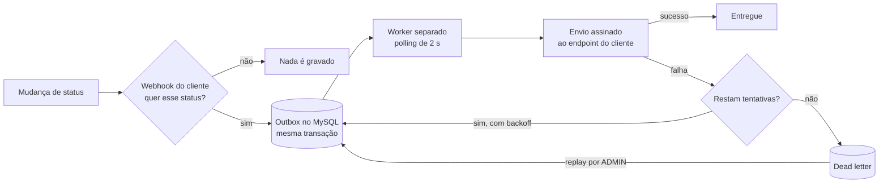

# RFC: Sistema de Webhooks de Notificação de Pedidos

## Metadados

| Campo | Valor |
| --- | --- |
| Autora | Larissa (Tech Lead), que se comprometeu a abrir o documento de design em [09:50] Larissa |
| Status | Em revisão |
| Data | 2026-11-01 |
| Revisores | Marcos (Product Manager), Bruno (Engenheiro Pleno, time de Pedidos), Diego (Engenheiro Sênior, time de Plataforma), Sofia (Engenheira de Segurança) |
| Documentos relacionados | [PRD](./PRD.md), [Índice de ADRs](./adrs/README.md) |

## Resumo executivo (TL;DR)

Propomos webhooks de saída com a primeira tentativa de envio em menos de 10 segundos ([09:02] Marcos), sem que a mudança de status espere pelo cliente. O evento é gravado numa outbox no MySQL existente, na mesma transação da mudança de status. Um worker em processo separado lê a outbox a cada 2 segundos e envia o evento assinado com HMAC-SHA256. Falhas são retentadas com backoff e depois vão para uma dead letter, reprocessada só por administrador. A entrega é at-least-once, a ordem vale por pedido enquanto houver um único worker e tudo fica num módulo no padrão do projeto, sem infraestrutura nova.

## Contexto e problema

`RFC-CTX-01` A aplicação não tem mecanismo de notificação externa. Os clientes descobrem mudanças consultando a API de tempos em tempos ([09:00] Marcos). O problema de negócio está no [PRD](./PRD.md#problema-e-motivação).

`RFC-CTX-02` O ponto de partida técnico é o `changeStatus`, cuja transação já atualiza o pedido, grava o histórico e mexe no estoque ([09:04] Bruno). Restrições:

- `RFC-CTX-03` A mudança de status não pode esperar o cliente nem ser desfeita porque ele está fora do ar ([09:04] Bruno).
- `RFC-CTX-04` O time é pequeno ([09:07] Diego).
- `RFC-CTX-05` Subir infraestrutura nova seria overengineering; o MySQL existente resolve ([09:07] Diego).

## Proposta técnica

A solução tem três blocos. A **captura do evento** acontece na API, na transação da mudança de status. A **entrega ao cliente** acontece no worker. A **configuração e gestão** é a API do cliente e do administrador.

### `RFC-PROP-01` Captura do evento

O `changeStatus` grava o evento dentro da transação existente e, se a gravação falhar, tudo faz rollback ([09:40] Bruno).

Sem webhook interessado no novo status, nada é gravado ([09:34] Bruno). O payload é montado e guardado nesse momento ([09:52] Larissa).

Decisões: [ADR-001](./adrs/ADR-001-outbox-no-mysql.md), [ADR-007](./adrs/ADR-007-snapshot-do-payload-na-insercao.md).

### `RFC-PROP-02` Entrega ao cliente

O worker é um processo separado da API, como entrada nova no mesmo projeto ([09:11] Larissa), na mesma stack e no mesmo banco ([09:11] Diego). A cada 2 segundos busca os pendentes mais antigos ([09:09] Diego), em lote pequeno ([09:08] Diego). Nesta fase há um único worker ([09:12] Diego).

Cada envio é assinado com HMAC-SHA256 sobre o corpo, com a secret do endpoint ([09:22] Sofia), e leva um identificador único do evento ([09:25] Diego).

Na falha, são até 5 tentativas com backoff exponencial ([09:17] Larissa), em cerca de 15 horas ([09:17] Diego). Depois o evento vai para uma dead letter separada da outbox, com payload, motivo e horário ([09:18] Diego).

Decisões: [ADR-002](./adrs/ADR-002-worker-separado-com-polling.md), [ADR-003](./adrs/ADR-003-retry-com-backoff-e-dlq.md), [ADR-004](./adrs/ADR-004-hmac-sha256-com-secret-por-endpoint.md), [ADR-005](./adrs/ADR-005-entrega-at-least-once-com-x-event-id.md).

### `RFC-PROP-03` Configuração e gestão

Os webhooks viram um módulo de domínio igual aos outros ([09:27] Bruno), reaproveitando `AppError`, Pino, error middleware e schemas Zod ([09:30] Larissa), com códigos de erro prefixados por `WEBHOOK_` ([09:29] Larissa).

O cliente gerencia seus endpoints pela API, identificado na requisição e não no token ([09:32] Larissa). Qualquer role autenticada pode fazer isso ([09:37] Sofia). A secret é gerada pela plataforma ([09:31] Marcos) e pode ser rotacionada com 24 horas de convivência ([09:21] Sofia). O cliente também consulta o histórico de entregas ([09:34] Marcos).

O replay da dead letter recoloca o evento na outbox como pendente ([09:18] Diego), exige role ADMIN com o `requireRole` existente ([09:36] Larissa) e registra quem o fez ([09:36] Sofia).

Decisões: [ADR-003](./adrs/ADR-003-retry-com-backoff-e-dlq.md), [ADR-004](./adrs/ADR-004-hmac-sha256-com-secret-por-endpoint.md), [ADR-006](./adrs/ADR-006-reuso-dos-padroes-do-projeto.md).

### Garantias e limites da proposta

- `RFC-PROP-04` **Garante** atomicidade: mudança commitada tem evento; rollback leva o evento junto ([09:06] Diego). [ADR-001](./adrs/ADR-001-outbox-no-mysql.md)
- `RFC-PROP-05` **Garante** que o evento reflete o pedido no momento da mudança ([09:52] Larissa). [ADR-007](./adrs/ADR-007-snapshot-do-payload-na-insercao.md)
- `RFC-PROP-06` **Garante** at-least-once, **não** exactly-once: o cliente pode receber duplicados ([09:24] Diego) e deduplica pelo identificador ([09:25] Diego). [ADR-005](./adrs/ADR-005-entrega-at-least-once-com-x-event-id.md)
- `RFC-PROP-07` **Não garante** ordem global: só por pedido e com um único worker ([09:13] Larissa). [ADR-002](./adrs/ADR-002-worker-separado-com-polling.md)
- `RFC-PROP-08` **Limite:** um evento pode esperar até 2 segundos para ser pego ([09:10] Larissa). [ADR-002](./adrs/ADR-002-worker-separado-com-polling.md)
- `RFC-PROP-09` **Limite:** após cerca de 15 horas de falhas ([09:17] Diego), a entrega só volta por replay manual ([09:18] Diego). [ADR-003](./adrs/ADR-003-retry-com-backoff-e-dlq.md)

## Alternativas consideradas

### `RFC-ALT-01` Disparo síncrono na mudança de status

Colocada em [09:03] Larissa e descartada em [09:04] Bruno: cliente lento travaria outros pedidos, e cliente fora do ar forçaria desfazer uma mudança válida. [ADR-001](./adrs/ADR-001-outbox-no-mysql.md)

### `RFC-ALT-02` Fila em infraestrutura nova (Redis Streams)

Levantada em [09:07] Larissa e descartada em [09:07] Diego como overengineering para um time pequeno. [ADR-001](./adrs/ADR-001-outbox-no-mysql.md)

### `RFC-ALT-03` Trigger no banco para acordar o worker

Sugerida em [09:09] Bruno e descartada em [09:09] Diego: a trigger do MySQL não notifica processo externo. [ADR-002](./adrs/ADR-002-worker-separado-com-polling.md)

### `RFC-ALT-04` Worker dentro do processo da API

Descartada em [09:11] Diego: se a API reinicia, o envio para junto. [ADR-002](./adrs/ADR-002-worker-separado-com-polling.md)

### `RFC-ALT-05` Entrega exactly-once

Descartada em [09:25] Diego: exigiria coordenação dos dois lados. [ADR-005](./adrs/ADR-005-entrega-at-least-once-com-x-event-id.md)

### `RFC-ALT-06` Montar o payload só no envio

Levantada em [09:51] Bruno e descartada em [09:52] Larissa: o evento deixaria de refletir o estado da mudança. [ADR-007](./adrs/ADR-007-snapshot-do-payload-na-insercao.md)

| Alternativa | Por que foi descartada | O que a proposta aceita em troca |
| --- | --- | --- |
| Disparo síncrono | Trava outros pedidos e forçaria rollback | Novo ponto de falha na transação |
| Redis Streams | Infraestrutura nova para time pequeno | Outbox crescendo no banco |
| Trigger no banco | Não notifica processo externo | Até 2 s de espera no pior caso |
| Worker na API | Reinício da API derruba o envio | Mais um processo para operar |
| Exactly-once | Coordenação dos dois lados | Deduplicação pelo cliente |
| Payload no envio | Evento perderia o retrato da mudança | Outbox maior (consequência inferida no ADR-007) |

## Questões em aberto

### `RFC-QA-01` Rate limiting de saída por cliente

Levantada em [09:38] Diego. Combinado: observar e decidir depois ([09:39] Larissa). Para fechar: observar e implementar se virar problema ([09:39] Diego).

### `RFC-QA-02` Escalar para vários workers

Levantada em [09:13] Bruno. Combinado: problema do futuro ([09:13] Diego), documentado como limitação conhecida ([09:13] Larissa). Para fechar: escolher entre particionar por pedido e lock pessimista ([09:13] Diego).

### `RFC-QA-03` Aviso por e-mail quando o webhook falha

Levantada em [09:37] Marcos. Combinado: fora desta fase ([09:37] Larissa). Para fechar: medir o impacto ([09:37] Larissa).

### `RFC-QA-04` Arquivamento dos eventos entregues

Levantada em [09:08] Diego. Combinado: fora do escopo desta feature ([09:08] Diego). Para fechar: Não definido na reunião.

### `RFC-QA-05` Restringir quem gerencia webhooks

Levantada em [09:36] Marcos. Combinado: qualquer role autenticada por enquanto ([09:37] Sofia). Para fechar: Não definido na reunião.

### Lacunas para os revisores

- `RFC-LAC-01` [PRD-FR-07](./PRD.md#prd-fr-07-enviar-o-evento-assinado-ao-cliente): evento acima de 64KB dá erro ([09:24] Larissa), mas o destino dele não foi definido.
- `RFC-LAC-02` [PRD-FR-08](./PRD.md#prd-fr-08-retentar-com-intervalo-crescente-e-separar-falhas-permanentes): o timeout conta como falha ([09:42] Diego), mas não foi definido que outras respostas contam.

## Impacto e riscos

### Impacto no sistema existente

- `RFC-IMP-01` `src/modules/orders/order.service.ts`: o `changeStatus` ganha a gravação do evento como um passo a mais, ao lado da atualização do pedido, do histórico e do estoque ([09:40] Bruno).
- `RFC-IMP-02` `src/server.ts`: segue como entrada da API; o worker vira outra entrada no mesmo molde, com script próprio no `package.json` ([09:11] Larissa).
- `RFC-IMP-03` `src/config/database.ts`: o worker cria seu próprio Prisma Client, no mesmo banco ([09:30] Bruno).
- `RFC-IMP-04` `src/shared/errors/app-error.ts` e `src/middlewares/error.middleware.ts`: reaproveitados sem mudança ([09:29] Bruno).
- `RFC-IMP-05` `src/middlewares/auth.middleware.ts`: `authenticate` e `requireRole` sem mudança ([09:36] Larissa); o token continua sem identificar o cliente ([09:32] Larissa).
- `RFC-IMP-06` `src/shared/logger/index.ts`: o Pino existente atende módulo e worker ([09:29] Bruno).
- `RFC-IMP-07` `prisma/schema.prisma`: ganha os modelos da outbox ([09:06] Diego), da dead letter ([09:18] Diego) e da configuração de webhook ([09:21] Bruno).
- `RFC-IMP-08` `src/routes/index.ts`: as rotas do módulo novo entram no `buildApiRouter`, como as dos outros módulos.
- `RFC-IMP-09` `src/modules/orders/order.status.ts`: nenhuma fala prevê mudança na máquina de estados.

### Riscos

| ID | Risco | Ângulo técnico | Mitigação (origem) |
| --- | --- | --- | --- |
| `RFC-RISCO-01` | Status muda sem evento ([PRD-RISCO-03](./PRD.md#prd-risco-03-status-do-pedido-muda-e-o-evento-não-é-registrado)) | A garantia depende da gravação dentro da transação | Mesma transação ([09:40] Bruno); testes ponta a ponta ([09:46] Larissa) |
| `RFC-RISCO-02` | Falha na outbox desfaz mudança válida | Rollback intencional ([09:40] Bruno) cria novo ponto de falha no fluxo de pedidos | Não definido na reunião |
| `RFC-RISCO-03` | Perda de ordem ao escalar ([PRD-RISCO-06](./PRD.md#prd-risco-06-perda-de-ordem-dos-eventos-ao-escalar-o-envio)) | Ordem depende de um único worker | Worker único, limitação documentada ([09:13] Larissa); `RFC-QA-02` |
| `RFC-RISCO-04` | Outbox grande deixa o worker lento ([09:07] Bruno) | Payload por linha, sem arquivamento | Leitura só dos pendentes, em lote pequeno ([09:08] Diego); `RFC-QA-04` |
| `RFC-RISCO-05` | Cliente lento ou fora do ar ([PRD-RISCO-01](./PRD.md#prd-risco-01-cliente-fica-fora-do-ar-por-muito-tempo-e-deixa-de-receber-eventos)) | Atraso fica no worker, não no pedido | Timeout de 10 s ([09:42] Diego); retry e dead letter ([09:17] Larissa) |
| `RFC-RISCO-06` | Evento duplicado ([PRD-RISCO-04](./PRD.md#prd-risco-04-cliente-recebe-o-mesmo-evento-mais-de-uma-vez)) | Efeito do at-least-once com retry | Identificador por evento ([09:25] Diego); destaque no portal ([09:26] Marcos) |
| `RFC-RISCO-07` | Vazamento de secret ([PRD-RISCO-02](./PRD.md#prd-risco-02-vazamento-da-secret-de-um-cliente)) | Alcance depende do modelo de chave | Secret por endpoint e rotação com 24 h ([09:21] Sofia); revisão de segurança ([09:46] Sofia) |

## Decisões relacionadas

| ADR | Decisão em uma frase | Onde foi decidida |
| --- | --- | --- |
| `RFC-DEC-01` [ADR-001](./adrs/ADR-001-outbox-no-mysql.md) | Outbox no MySQL, gravada na transação da mudança de status | [09:08] Larissa; [09:40] Bruno |
| `RFC-DEC-02` [ADR-002](./adrs/ADR-002-worker-separado-com-polling.md) | Worker separado com polling de 2 segundos | [09:10] Larissa; [09:11] Diego |
| `RFC-DEC-03` [ADR-003](./adrs/ADR-003-retry-com-backoff-e-dlq.md) | 5 tentativas com backoff, dead letter e replay manual | [09:17] Larissa; [09:18] Diego |
| `RFC-DEC-04` [ADR-004](./adrs/ADR-004-hmac-sha256-com-secret-por-endpoint.md) | HMAC-SHA256, secret por endpoint e rotação de 24 h | [09:22] Sofia |
| `RFC-DEC-05` [ADR-005](./adrs/ADR-005-entrega-at-least-once-com-x-event-id.md) | At-least-once com identificador por evento | [09:26] Larissa |
| `RFC-DEC-06` [ADR-006](./adrs/ADR-006-reuso-dos-padroes-do-projeto.md) | Módulo no padrão do projeto, reusando erros, logs, Zod e `requireRole` | [09:30] Larissa; [09:36] Larissa |
| `RFC-DEC-07` [ADR-007](./adrs/ADR-007-snapshot-do-payload-na-insercao.md) | Payload montado e gravado na inserção | [09:52] Larissa; [09:52] Bruno |
